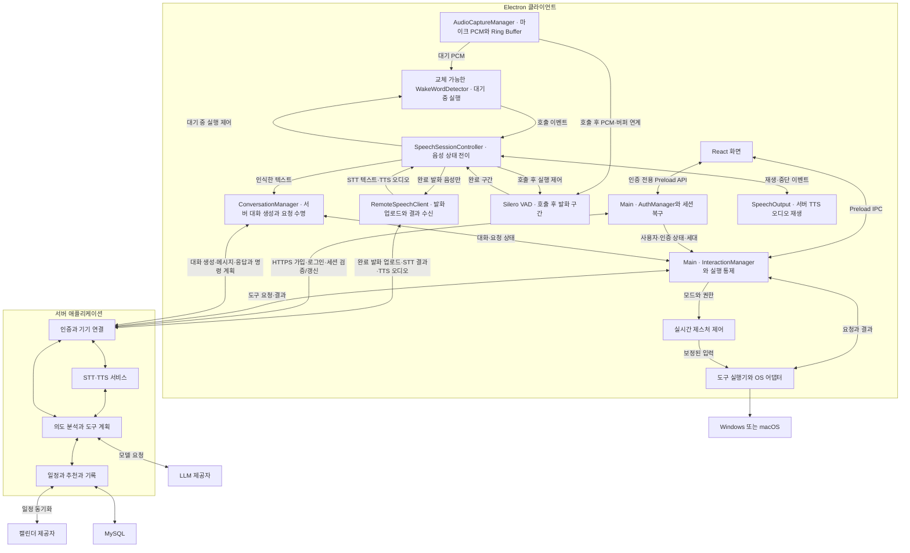

# 클라이언트 아키텍처

Electron 실행 공간과 클라이언트 모듈의 원본 문서다. 서버 내부 역할은 [서버 연동](server-integration.md)을 참조한다.

모듈 사이의 데이터·호출·오류·좌표·시간·자원 정리 규칙은 [클라이언트 공통 인터페이스](client-interfaces.md)를 따른다.

로그인·회원가입·로그인 유지와 기능 허용 정책은 [계정 인증](../features/auth.md)을 따른다. AuthManager가 세션을 확인하기 전에는 로그인·회원가입 화면만 표시하고 주요 기능을 시작하지 않는다.

아래 구조는 서버 ERD 반영 후의 목표 책임도 포함한다. 실제 구현은 로컬 대화 ID·개발용 서버 대역 기반이며 서버 대화 생성·새 명령 결과 보고·활동/추천/일정 연동은 후속이다. 원격 계약은 [서버 연동](server-integration.md)에, 현재 포트와의 차이는 [공통 인터페이스](client-interfaces.md#서버-erd-연동-시-확장-경계)에 둔다.

## 전체 아키텍처

### 클라이언트 실행 경계

| 실행 공간 | 책임 | 경계 |
| --- | --- | --- |
| Main | 생명주기, 트레이·단축키·창, AuthManager의 인증·세션 복구·접근 제한, SpeechSessionController의 상태 전이, 서버 연결, 레지스트리, 도구 검증·조정 | 고비용 추론이나 장시간 블로킹 입력 처리를 직접 수행하지 않음 |
| UI Renderer | 로그인·회원가입, 오버레이, 설정, 입력·결과·확인 화면 | OS 직접 제어와 임의 IPC 금지. 제한된 Preload API 사용. 인증 토큰을 소유하지 않음 |
| Media Renderer | getUserMedia·AudioWorklet으로 마이크 PCM과 제한된 Ring Buffer 관리, 영상 프레임 전달, 서버 TTS 오디오 재생 | 공통 PCM을 상태별 KWS/VAD에 연결. 오디오 전송·인증은 Main에 위임. 화면과 생명주기를 분리하고 비표시·잠금·최소화 상태에서 유지 여부 검증 |
| Web Worker | MediaPipe 등 웹 추론, 좌표·제스처 특징 처리 | 최신 프레임 위주로 처리하고 무제한 프레임 대기열 방지 |
| 별도 인식 프로세스 | KWS 어댑터·Silero VAD 등 로컬 추론 실행 | 완료 발화 구간을 SpeechSessionController에 반환. 장애 격리·재시작·자원 제한. Node 작업은 utilityProcess, 외부 실행 파일은 spawn 등 엔진에 맞게 선택 |
| 네이티브 실행 모듈 | OS 입력·창 조회·전환 | Windows와 macOS 구현을 공통 인터페이스 뒤에 배치. 필요 시 별도 프로세스 격리 |

로컬 KWS·VAD의 실제 실행 위치(Worker·utilityProcess·외부 프로세스)는 Electron 패키징과 지연 측정으로 결정한다. PCM의 소유권은 AudioCaptureManager에 두고, 완료 발화만 Main의 RemoteSpeechClient를 통해 서버에 보낸다. 세션 ID와 상태 버전으로 지연된 로컬 추론 및 서버 STT·TTS 결과를 폐기한다. MediaPipe의 웹 손 인식은 동기 추론이므로 Worker 분리를 기본안으로 삼는다. GPU·WASM·영상 전달 방식의 실제 조합은 대상 Electron 환경에서 검증한다. Worker와 OS 입력 모듈 사이의 메시지는 세션·모드 버전으로 검증해 모드 종료 후 도착한 좌표를 폐기한다.

### 클라이언트 논리 모듈

| 모듈 | 주요 책임 |
| --- | --- |
| ApplicationManager | 창·트레이·단축키·앱 생명주기 |
| AuthManager | 로그인·가입·중복 확인, 인증 세대·상태, 보호 자격 증명 저장·복구·갱신·제거, 모든 진입점의 인증 확인과 로그아웃 정리 조정 |
| LocalState(F-023) | 설치 식별자·기기 설정 저장과 앱 시작 초기화. 파일·실패 규칙은 [데이터와 보안](data-security.md#기기-로컬-저장-형식) 참조 |
| 인증 어댑터의 기기 연결(후속) | 로컬 설치 식별자를 로그인 요청에 포함하고 서버가 등록·연결한 현재 기기를 확인. AuthManager와 세대를 연결하고 서버 기능의 준비 상태 제공. 계약은 [계정 인증](server-integration.md#계정-인증-계약) 참조 |
| SensorManager | 장치 선택, 권한, 기능별 사용 소유권, 센서 정리 |
| PerceptionManager | 손 추적 등 비음성 인식 엔진 관리. 음성 엔진 상태 관리는 SpeechSessionController에 위임 |
| AudioCaptureManager | 공통 마이크 PCM 수집·리샘플링·길이 제한 Ring Buffer·수명 관리. KWS와 VAD에 상태별 입력 제공 |
| WakeWordDetector | F-024의 Vosk 별도 추론 프로세스와 교체 가능한 KWS 포트. 음성 호출이 켜진 대기 상태에서만 PCM 처리. 구현·한계는 [음성 원본](../features/speech.md#호출어-감지-구현과-검증) 참조 |
| SpeechSessionController | 대기·호출·발화·서버 STT 대기·응답·후속 발화 상태 전이와 로컬 KWS/VAD 활성화. 버퍼 연계, 타임아웃, TTS 재생 중 입력 억제, 취소·마이크 중지·권한 철회 처리 |
| VoiceActivityDetector | 호출 후 Silero VAD로 발화 시작·끝·무음 타임아웃 판단. 완료된 발화 구간만 음성 전송 대상으로 확정 |
| RemoteSpeechClient | 완료 발화의 인증된 업로드, 서버 STT 결과·TTS 오디오 수신, 취소·기한·세션 버전 검증. 전송 구현은 ConnectionManager를 사용 |
| InteractionManager | UI에 보이는 상태(스냅샷)·명령 진입점·호출 통합 |
| ConversationManager | 서버 대화 생성과 식별(`conversationId`), 요청·실행 전 안내·명령 처리·완료·취소·유휴 종료. 입력이 음성이든 글이든 같음. 음성 세션과의 관계는 [음성 명세](../features/speech.md#대화와-음성-세션의-관계) |
| GestureController | 좌표 변환·필터·Pinch 상태·전환·추적 손실·로컬 중지 |
| ConnectionManager | AuthManager의 현재 인증에 연결한 WSS·HTTPS 전송, 음성 데이터 전송, 상태 보고·재연결·메시지 유효성. 인증 비밀은 Main 내부에서만 사용 |
| CapabilityRegistry | 지원 도구, 스키마, 권한·일시 가용 상태 |
| ToolExecutor | 도구 검증·중복 방지·실행 직전 재검증·결과 수집 |
| PlatformAdapter | 앱·창·입력·권한의 Windows·macOS 차이 |
| SpeechOutput | 서버에서 받은 TTS 오디오 재생·중단 이벤트를 SpeechSessionController에 전달해 자체 출력 재인식 방지 |
| SettingsAndRecords | 설정, 사용자별 전송 대기 기록·삭제 대기 요청, 최소 진단 로그. 계정 전환 시 이전 사용자의 데이터·대기 작업을 새 사용자에게 적용하지 않음 |
| 활동 관측·추천 담당 Main 모듈(후속) | 동의 범위의 OS 앱 활동 관측·중복 제거·정책 버전별 전송, 추천 표시 상태와 서버 승인 연동. 명령 실행·결과는 기존 도구 계층 사용 |

WakeWordDetector의 입력은 AudioCaptureManager가 정규화한 PCM 프레임이며, 출력은 호출어와 감지 시각·오디오 경계를 담은 이벤트다. 엔진별 초기화·시작·중지·상태 초기화는 같은 인터페이스로 감싸 모델 교체가 SpeechSessionController의 상태 규칙을 바꾸지 않도록 한다. 마이크 권한과 장치 수명은 SensorManager가 관리하고, 음성 세션은 오디오 버퍼의 사용·폐기 시점만 요청한다.

### 앱 실행 기반 구현

`main/application/`은 단일 인스턴스·앱 이벤트·UiWindow의 수명을 관리하며 `ApplicationManager`는 각 기능을 조립만 한다. 트레이(`tray.ts`)·단축키(`shortcuts.ts`)·앱 상태와 명령의 연결(`state-sync.ts`)·개발용 셀프테스트(`dev-selftests.ts`)는 별도 모듈이고 각각 정리 함수를 돌려주며 `release-all.ts`가 한 해제의 실패가 나머지를 막지 않도록 묶는다. 여러 계층이 함께 쓰는 포트는 `shared/ports/`에 두어 `main`·`workers`가 `renderer`를 가져오지 않는다. `main/interaction/interaction-manager.ts`는 초기 미로그인 상태와 화면·명령을 관리한다. `main/ipc/ui-ipc.ts`는 소유 UI 창의 검증된 호출만 받아 상태와 결과를 전달한다. 현재 미구현 주요 기능은 시작하지 않으며 인증 없이 허용할 중지·종료를 구분한다.

F-023의 `ApplicationManager.start()`는 로컬 저장 초기화를 기다리는 Promise를 반환하며 중복 호출은 같은 시작 작업을 공유한다. Main의 `settings/create-local-state.ts`가 userData 저장소를 구성한다. 정상 초기화 뒤에만 창·단축키·인증 복구를 시작하고 실패/종료 경로는 [저장 형식 원본](data-security.md#기기-로컬-저장-형식)을 따른다. 기기 등록의 서버 준비 상태와 로컬 저장 초기화 성공은 별개다.

창은 명시적 사용자 호출 시에만 표시·복원·포커스한다. 닫기는 트레이 숨김으로 처리하고 종료가 시작되면 숨김을 해제해 실제 창 닫기를 허용한다. 트레이가 없으면 창 닫기로 유일한 접근 경로를 잃지 않는다. 앱 종료는 소유 단축키·트레이·IPC·구독을 한 번만 해제하며 종료 중 재호출로 창을 만들지 않는다. 자세한 동작은 [호출과 화면](../features/interaction-ui.md#앱-실행-기반)을 따른다.

## 권장 클라이언트 스택

| 영역 | 기본안 | 결정 상태 |
| --- | --- | --- |
| 앱·언어 | Electron·TypeScript | 기존 논의 기준 |
| UI | React·Tailwind CSS·Zustand | 기본안. Zustand는 화면 상태를 관리하고 실행 상태의 원본은 Main에 둠 |
| 빌드·배포 | Vite·electron-builder·GitHub Actions | 기본안. OS·CPU별 산출물과 서명 검증 필요 |
| 미디어 | getUserMedia·Web Audio API·AudioWorklet·PCM Ring Buffer | 공통 입력 기본안. 마이크 권한·백그라운드 유지·리샘플링·버퍼 상한 검증 |
| 손 추적 | @mediapipe/tasks-vision | 기본안. Pinch·호출·전환 판정은 별도 규칙 구현 |
| Wake Word | WakeWordDetectorPort 뒤 Vosk 0.3.39·Koffi 3.3.3·vosk-model-small-ko-0.22 | 초기 호출어 구현. 실제 화자 오탐/미탐·지연과 OS별 실기기 검증은 완료 상태와 구분해 기록 |
| VAD | Silero VAD | 호출 후 발화 시작·끝·무음 타임아웃 기본 후보. PCM 형식·실행 위치·지연·종료 무음 길이 검증 |
| STT | 서버 Speech 서비스 | 로컬 VAD가 확정한 발화만 전송. 한국어 정확도·지연·동시 처리량·장애·비용과 서버 데이터 처리 정책 검증 |
| TTS | 서버 Speech 서비스와 클라이언트 오디오 재생 | 서버 음성 품질·응답 지연·오디오 형식과 Media Renderer의 재생·중단 검증 |
| 통신·검증 | Main의 WebSocket 클라이언트·HTTPS·Zod | 인증된 음성 업로드·오디오 수신과 도구 제어 계약 분리 |
| 로컬 저장 | Main의 원자적 JSON 파일, 필요 시 SQLite | F-023의 설치 키·기기 설정은 Node 파일 포트 뒤에서 관리. 대기열·삭제 일관성 요구에 따라 SQLite 등 별도 저장소 채택 |
| 민감정보 | Electron safeStorage | 지원·가용 상태 확인 후 인증 자격 증명 암호화 |
| 린트·포맷 | Oxlint·Oxfmt | TypeScript 7이 typescript-eslint 지원 범위 밖이어서 TS 컴파일러 API에 의존하지 않는 도구를 사용. 타입 검사는 tsc가 담당. Renderer·Worker·공유 계약의 `electron`·Node·Main 직접 import는 린트로 금지해 실행 경계를 강제 |
| 테스트 | Vitest | 단위·통합 테스트(`tests/unit`, `tests/integration`). 시계·OS 입력·인식 엔진·서버 연결은 인터페이스 뒤에 두고 가짜 객체나 로컬 테스트 서버로 대체. Electron 앱 E2E는 필요 시점에 별도 결정 |
| OS 제어 | Electron API·Node.js·플랫폼별 네이티브 어댑터 | 입력·외부 창 제어 구현체는 기술 검증 후 확정 |

TypeScript는 앱 제어 로직과 연결 계층의 주 언어다. MediaPipe·Silero VAD·Vosk·OS 입력은 기존 엔진을 활용한다. KWS 엔진과 모델은 교체 가능한 경계로 유지한다. 클라이언트의 Vosk ASR 모델은 호출어 판별에만 사용하며 일반 명령 STT·응답 TTS 모델은 서버가 담당한다. 오디오와 로컬 인식 본문은 추론 과정 뒤 폐기한다. 클라이언트의 MCP 서버는 MVP 필수가 아니며 기능 레지스트리·WSS·도구 실행기로 연동한다.

### 독립 상태

| 상태 영역 | 상태 예시 | 유지 원칙 |
| --- | --- | --- |
| 인증 | checking, signed_out, signed_in | Main이 소유. 주요 기능을 허용하는 전제이며 연결 상태와 구분. 로그아웃·세션 무효화 시 기존 요청·인식·입력 정리. 상세 전이는 계정 인증 원본을 따름 |
| 대화 | 현재 idle, active; 목표는 서버 생성 대기·실패도 구분 | ConversationManager가 `conversationId`·요청·유휴 종료를 관리. 서버 생성 상태의 실제 타입은 연동 시 확정. 입력이 음성이든 글이든 같고 음성 세션이 없어도 존재할 수 있음. 끝나면 음성 세션도 끝남 |
| 음성 세션 | idle, wake_detected, awaiting_speech, listening, transcribing, processing, speaking, awaiting_followup | 대화에 붙는 듣기·말하기. transcribing은 서버 STT 대기, processing은 대화의 응답 대기, speaking은 서버 TTS 오디오 재생. SpeechSessionController가 전이를 관리하고 종료 시 제스처를 변경하지 않음 |
| 제스처 | off, tracking, lost, suspended | 로컬 중지 우선. 복구 시 중립 입력부터 시작 |
| 센서 | 미사용, 사용 중, 권한 없음, 장치 오류 | 기능별 소유권으로 사용 관리. 음성 호출 대기는 마이크 사용 기능으로 계산 |
| 화면 | 로그인, 회원가입, 숨김, 상태 표시, 입력, 결과, 확인, 설정 | 인증 확인 전에는 인증 화면만 허용. 결과 창 닫기와 기능 종료를 구분 |
| 요청 | created, processing, awaiting_confirmation, executing, terminal | 대화 안의 한 요청. 실행 전 응답·로컬 실행 종료·결과 보고 완료/대기를 구분. terminal 결과를 성공·실패·취소·만료·확인 불가로 구분. 현재 구현은 idle·processing만 사용하며 새 단계 타입은 후속 서버 연동에서 확정 |
| 추천 | created, shown, approved, rejected, dismissed, expired | 실행 결과는 별도 필드로 연결 |
