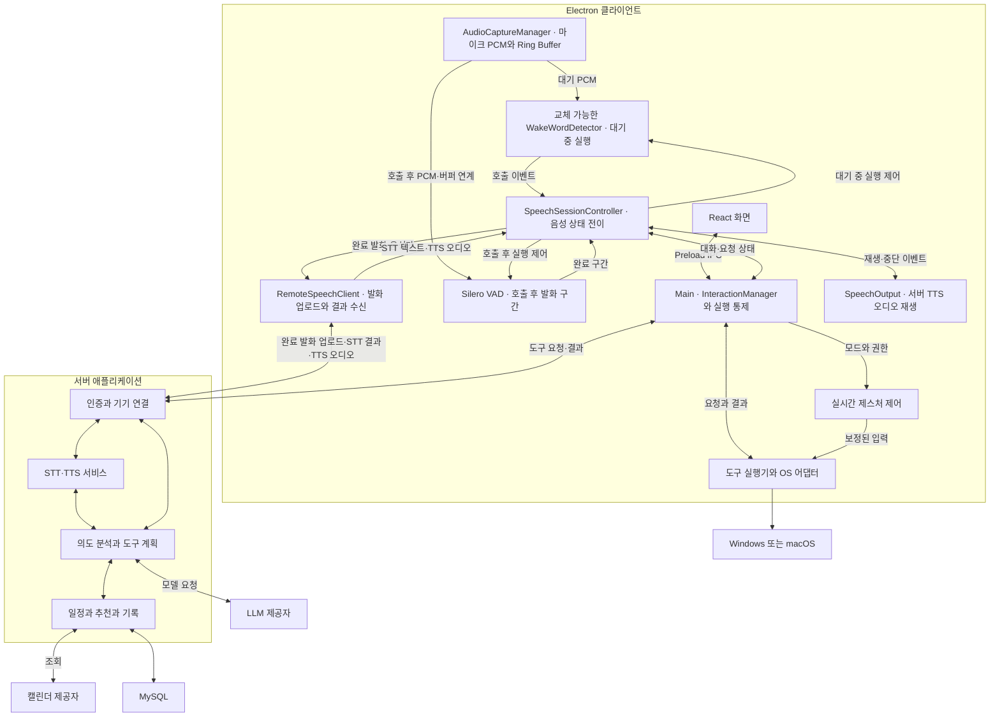

# 클라이언트 아키텍처

Electron 실행 공간과 클라이언트 모듈의 원본 문서다. 서버 내부 역할은 [서버 연동](server-integration.md)을 참조한다.

모듈 사이의 데이터·호출·오류·좌표·시간·자원 정리 규칙은 [클라이언트 공통 인터페이스](client-interfaces.md)를 따른다.

## 전체 아키텍처

### 클라이언트 실행 경계

| 실행 공간 | 책임 | 경계 |
| --- | --- | --- |
| Main | 생명주기, 트레이·단축키·창, SpeechSessionController의 상태 전이, 인증 연결, 레지스트리, 도구 검증·조정 | 고비용 추론이나 장시간 블로킹 입력 처리를 직접 수행하지 않음 |
| UI Renderer | 오버레이, 설정, 입력·결과·확인 화면 | OS 직접 제어와 임의 IPC 금지. 제한된 Preload API 사용 |
| Media Renderer | getUserMedia·AudioWorklet으로 마이크 PCM과 제한된 Ring Buffer 관리, 영상 프레임 전달, 서버 TTS 오디오 재생 | 공통 PCM을 상태별 KWS/VAD에 연결. 오디오 전송·인증은 Main에 위임. 화면과 생명주기를 분리하고 비표시·잠금·최소화 상태에서 유지 여부 검증 |
| Web Worker | MediaPipe 등 웹 추론, 좌표·제스처 특징 처리 | 최신 프레임 위주로 처리하고 무제한 프레임 대기열 방지 |
| 별도 인식 프로세스 | KWS 어댑터·Silero VAD 등 로컬 추론 실행 | 완료 발화 구간을 SpeechSessionController에 반환. 장애 격리·재시작·자원 제한. Node 작업은 utilityProcess, 외부 실행 파일은 spawn 등 엔진에 맞게 선택 |
| 네이티브 실행 모듈 | OS 입력·창 조회·전환 | Windows와 macOS 구현을 공통 인터페이스 뒤에 배치. 필요 시 별도 프로세스 격리 |

로컬 KWS·VAD의 실제 실행 위치(Worker·utilityProcess·외부 프로세스)는 Electron 패키징과 지연 측정으로 결정한다. PCM의 소유권은 AudioCaptureManager에 두고, 완료 발화만 Main의 RemoteSpeechClient를 통해 서버에 보낸다. 세션 ID와 상태 버전으로 지연된 로컬 추론 및 서버 STT·TTS 결과를 폐기한다. MediaPipe의 웹 손 인식은 동기 추론이므로 Worker 분리를 기본안으로 삼는다. GPU·WASM·영상 전달 방식의 실제 조합은 대상 Electron 환경에서 검증한다. Worker와 OS 입력 모듈 사이의 메시지는 세션·모드 버전으로 검증해 모드 종료 후 도착한 좌표를 폐기한다.

### 클라이언트 논리 모듈

| 모듈 | 주요 책임 |
| --- | --- |
| ApplicationManager | 창·트레이·단축키·앱 생명주기 |
| SensorManager | 장치 선택, 권한, 기능별 사용 소유권, 센서 정리 |
| PerceptionManager | 손 추적 등 비음성 인식 엔진 관리. 음성 엔진 상태 관리는 SpeechSessionController에 위임 |
| AudioCaptureManager | 공통 마이크 PCM 수집·리샘플링·길이 제한 Ring Buffer·수명 관리. KWS와 VAD에 상태별 입력 제공 |
| WakeWordDetector | 교체 가능한 KWS 인터페이스와 호출 이벤트. 음성 호출이 켜진 대기 상태에서만 지속 실행; sherpa-onnx는 검증 우선 후보 |
| SpeechSessionController | 대기·호출·발화·서버 STT 대기·응답·후속 발화 상태 전이와 로컬 KWS/VAD 활성화. 버퍼 연계, 타임아웃, TTS 재생 중 입력 억제, 취소·마이크 중지·권한 철회 처리 |
| VoiceActivityDetector | 호출 후 Silero VAD로 발화 시작·끝·무음 타임아웃 판단. 완료된 발화 구간만 음성 전송 대상으로 확정 |
| RemoteSpeechClient | 완료 발화의 인증된 업로드, 서버 STT 결과·TTS 오디오 수신, 취소·기한·세션 버전 검증. 전송 구현은 ConnectionManager를 사용 |
| InteractionManager | 대화·요청·승인 상태, 호출 통합, 취소·만료 |
| GestureController | 좌표 변환·필터·Pinch 상태·전환·추적 손실·로컬 중지 |
| ConnectionManager | WSS·HTTPS 인증, 음성 데이터 전송, 상태 보고·재연결·메시지 유효성 |
| CapabilityRegistry | 지원 도구, 스키마, 권한·일시 가용 상태 |
| ToolExecutor | 도구 검증·중복 방지·실행 직전 재검증·결과 수집 |
| PlatformAdapter | 앱·창·입력·권한의 Windows·macOS 차이 |
| SpeechOutput | 서버에서 받은 TTS 오디오 재생·중단 이벤트를 SpeechSessionController에 전달해 자체 출력 재인식 방지 |
| SettingsAndRecords | 설정, 전송 대기 기록, 삭제 대기 요청, 최소 진단 로그 |

WakeWordDetector의 입력은 AudioCaptureManager가 정규화한 PCM 프레임이며, 출력은 호출어와 감지 시각·오디오 경계를 담은 이벤트다. 엔진별 초기화·시작·중지·상태 초기화는 같은 인터페이스로 감싸 모델 교체가 SpeechSessionController의 상태 규칙을 바꾸지 않도록 한다. 마이크 권한과 장치 수명은 SensorManager가 관리하고, 음성 세션은 오디오 버퍼의 사용·폐기 시점만 요청한다.

## 권장 클라이언트 스택

| 영역 | 기본안 | 결정 상태 |
| --- | --- | --- |
| 앱·언어 | Electron·TypeScript | 기존 논의 기준 |
| UI | React·Tailwind CSS·Zustand | 기본안. Zustand는 화면 상태를 관리하고 실행 상태의 원본은 Main에 둠 |
| 빌드·배포 | Vite·electron-builder·GitHub Actions | 기본안. OS·CPU별 산출물과 서명 검증 필요 |
| 미디어 | getUserMedia·Web Audio API·AudioWorklet·PCM Ring Buffer | 공통 입력 기본안. 마이크 권한·백그라운드 유지·리샘플링·버퍼 상한 검증 |
| 손 추적 | @mediapipe/tasks-vision | 기본안. Pinch·호출·전환 판정은 별도 규칙 구현 |
| Wake Word | 교체 가능한 WakeWordDetector; sherpa-onnx KWS 우선 검증 후보 | “자비스” 한국어 모델·오탐/미탐·지연·OS/CPU·엔진과 모델/학습 데이터 라이선스 및 재배포 조건 검증 후 확정 |
| VAD | Silero VAD | 호출 후 발화 시작·끝·무음 타임아웃 기본 후보. PCM 형식·실행 위치·지연·종료 무음 길이 검증 |
| STT | 서버 Speech 서비스 | 로컬 VAD가 확정한 발화만 전송. 한국어 정확도·지연·동시 처리량·장애·비용과 서버 데이터 처리 정책 검증 |
| TTS | 서버 Speech 서비스와 클라이언트 오디오 재생 | 서버 음성 품질·응답 지연·오디오 형식과 Media Renderer의 재생·중단 검증 |
| 통신·검증 | Main의 WebSocket 클라이언트·HTTPS·Zod | 인증된 음성 업로드·오디오 수신과 도구 제어 계약 분리 |
| 로컬 저장 | electron-store, 필요 시 SQLite | 설정은 electron-store. 대기열·삭제 일관성 요구에 따라 SQLite 채택 |
| 민감정보 | Electron safeStorage | 지원·가용 상태 확인 후 인증 자격 증명 암호화 |
| 린트·포맷 | Oxlint·Oxfmt | TypeScript 7이 typescript-eslint 지원 범위 밖이어서 TS 컴파일러 API에 의존하지 않는 도구를 사용. 타입 검사는 tsc가 담당. Renderer·Worker·공유 계약의 `electron`·Node·Main 직접 import는 린트로 금지해 실행 경계를 강제 |
| 테스트 | Vitest | 단위·통합 테스트(`tests/unit`, `tests/integration`). 시계·OS 입력·인식 엔진·서버 연결은 인터페이스 뒤에 두고 가짜 객체나 로컬 테스트 서버로 대체. Electron 앱 E2E는 필요 시점에 별도 결정 |
| OS 제어 | Electron API·Node.js·플랫폼별 네이티브 어댑터 | 입력·외부 창 제어 구현체는 기술 검증 후 확정 |

TypeScript는 앱 제어 로직과 연결 계층의 주 언어다. MediaPipe·sherpa-onnx 후보·Silero VAD·OS 입력은 기존 엔진을 활용하며, 모든 내부 구현을 TypeScript로 다시 작성하지 않는다. KWS 엔진과 모델은 분리해 교체할 수 있게 하고 라이선스·배포 가능성 확인 전 특정 모델을 확정하지 않는다. 클라이언트에 STT·TTS 모델을 포함하지 않는다. 클라이언트의 MCP 서버는 MVP 필수가 아니며 기능 레지스트리·WSS·도구 실행기로 연동한다.

### 독립 상태

| 상태 영역 | 상태 예시 | 유지 원칙 |
| --- | --- | --- |
| 대화/음성 세션 | idle, wake_detected, awaiting_speech, listening, transcribing, processing, speaking, awaiting_followup | transcribing은 서버 STT 대기, speaking은 서버 TTS 오디오 재생. SpeechSessionController가 전이를 관리하고 종료 시 제스처를 변경하지 않음 |
| 제스처 | off, tracking, lost, suspended | 로컬 중지 우선. 복구 시 중립 입력부터 시작 |
| 센서 | 미사용, 사용 중, 권한 없음, 장치 오류 | 기능별 소유권으로 사용 관리. 음성 호출 대기는 마이크 사용 기능으로 계산 |
| 화면 | 숨김, 상태 표시, 입력, 결과, 확인, 설정 | 결과 창 닫기와 기능 종료를 구분 |
| 요청 | created, processing, awaiting_confirmation, executing, terminal | terminal 결과를 성공·실패·취소·만료·확인 불가로 구분 |
| 추천 | created, shown, approved, rejected, dismissed, expired | 실행 결과는 별도 필드로 연결 |
