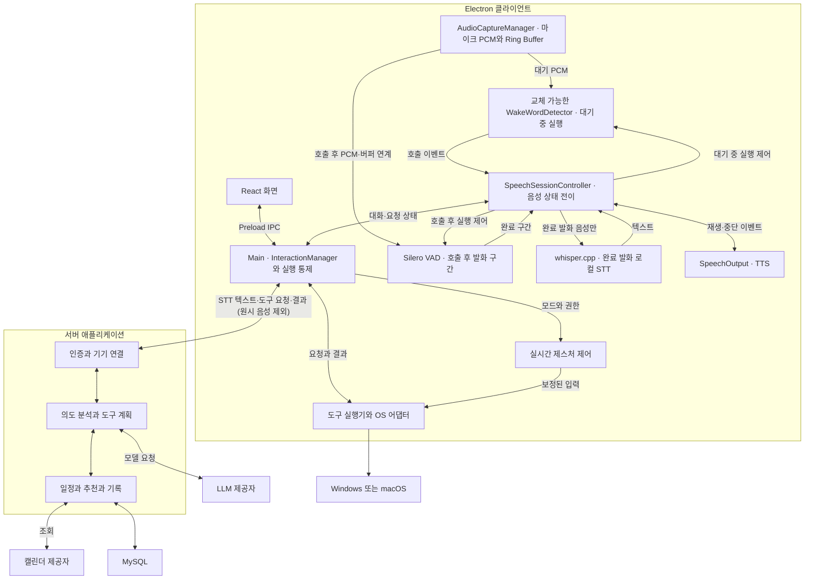
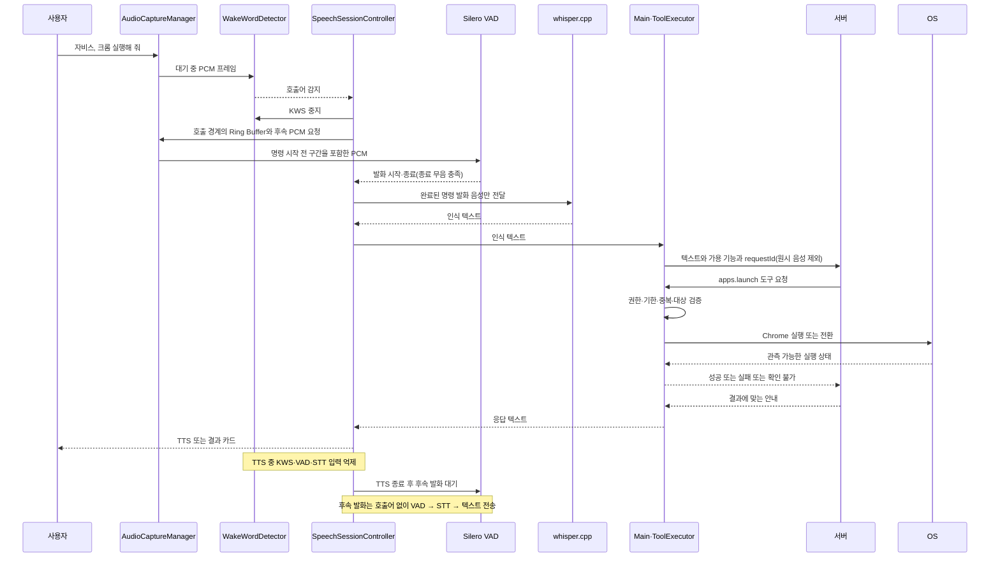

> 보관본: 2026-10-19 통합 명세 v0.2. 현재 기준 문서는 [문서 목차](../README.md)를 따른다.

# 자비스 기능 명세와 시스템 아키텍처

작성일: 2026년 10월 19일 · 버전: 0.2 · 상태: 개발 기준 초안

자비스는 Windows와 macOS에서 백그라운드로 동작하는 AI 개인 비서다. 음성·제스처·단축키로 호출하고, 작은 오버레이와 필요한 순간에만 표시되는 창으로 상호작용한다. Electron 클라이언트가 센서 입력·로컬 인식·PC 제어를 담당하며, 서버는 자연어 요청 해석·외부 서비스 연동·기록 기반 추천을 담당한다.

## 1. 범위와 설계 원칙

### 1.1. MVP 범위

| 영역 | MVP 포함 범위 |
| --- | --- |
| 호출 | 한국어 Wake Word, 제스처, 글로벌 단축키, 시스템 트레이 |
| 인터페이스 | 포커스를 빼앗지 않는 상태 오버레이, 임시 입력·결과·확인 창, 설정 |
| 음성 | 공통 PCM 입력·순환 버퍼, 대기 중 로컬 호출어 감지, 호출 후 VAD·로컬 STT, 서버 의도 분석, TTS |
| 앱 제어 | 앱 식별·상태 조회, 실행·전환, 호출 전 작업 복귀, 기본 브라우저 URL 열기 |
| 제스처 제어 | 명시적 시작·종료, 검지 커서 이동, Pinch 단일 클릭, 최근 작업 전환 |
| 실행 이력·추천 | 자비스를 통한 앱 실행 이력, 이력 기반 연관 앱 추천, 승인·거절·만료 처리 |
| 일정 | 외부 캘린더 1종 연결·해제, 자연어 기간 조회, 연결·조회 상태 |
| 공통 기반 | 사용자·기기 인증, 기능 가용 상태, 취소·만료, 로그, 수집·삭제 설정 |

MVP에서는 자비스를 통해 수행한 앱 실행만 행동 분석 대상으로 삼는다. 사용자가 직접 실행한 모든 앱을 상시 관찰하는 기능은 확장 범위다. AR 캐릭터, 일정 생성·수정·삭제, 자유로운 화면 조작 에이전트도 MVP에 포함하지 않는다.

### 1.2. 처리 원칙

- 마이크 PCM 수집·호출어 감지·VAD·STT와 영상 인식은 클라이언트에서 수행한다. 음성 요청에는 완료된 발화의 STT 텍스트와 필요한 이벤트·결과만 서버로 전송하며 원시 오디오는 서버로 보내지 않는다.
- 음성 호출 기능이 켜진 대기 상태에서만 마이크 입력과 WakeWordDetector를 계속 실행한다. 호출 후에는 VAD로 발화 구간을 확정하고 그 구간만 로컬 STT에 전달한다.
- 커서 이동·클릭·추적 손실 처리·긴급 중지는 서버나 LLM의 응답을 기다리지 않는다.
- 서버는 등록된 도구를 요청하고, 클라이언트가 권한·현재 상태·요청 유효성을 검증해 실행한다.
- 대화, 제스처, 센서, 화면 상태를 분리한다. 하나의 종료가 다른 기능을 임의로 종료하지 않는다.
- 서버는 초기에는 하나의 애플리케이션 내부 모듈로 구성한다. 도표의 역할 구분이 서버 분리를 의미하지 않는다.

## 2. 기능 명세

표의 ID는 이 초안에서 사용할 요구사항 식별자다. MVP는 완료 필수 기능, 확장은 후속 개발 기능이다.

### 2.1. 호출과 화면

| ID | 기능 | 동작 기준과 완료 조건 | 범위 |
| --- | --- | --- | --- |
| CALL-01 | 음성 호출 | 음성 호출이 켜진 대기 상태에서 교체 가능한 WakeWordDetector가 설정한 한국어 호출어를 로컬 감지해 대화를 활성화. 공통 Ring Buffer의 호출 직후 음성을 첫 발화로 연계해 “자비스, …” 연속 명령을 보존. 일시 중지·권한 철회·마이크 중지 시 감지 중단 | MVP |
| CALL-02 | 제스처 호출 | 지정 동작과 유지 조건 충족 시 호출. 제어 모드 시작과 호출을 구분하고 재호출 제한 적용 | MVP |
| CALL-03 | 단축키 호출 | 기본·사용자 지정 단축키로 호출. 등록 실패·충돌을 표시하고 대체 경로 제공 | MVP |
| CALL-04 | 트레이 제어 | 호출, 설정 열기, 인식 일시 중지·재개, 제스처 중지, 앱 종료 제공 | MVP |
| UI-01 | 상태 오버레이 | 대기·듣기·처리·응답·오류와 제스처 상태 표시. 상태 표시만으로 작업 앱 입력 포커스를 빼앗지 않음 | MVP |
| UI-02 | 임시 입력·결과 창 | 텍스트 입력이나 상세 결과가 필요할 때 표시. 사용자가 입력 창을 명시적으로 열면 포커스 허용 | MVP |
| UI-03 | 확인·추천 창 | 대상·행동·유효 상태를 표시. 닫기를 승인으로 해석하지 않음 | MVP |
| UI-04 | 설정 | 입력 장치, 호출·제스처, 음성 출력, 단축키, 계정, 기록 설정 관리 | MVP |

### 2.2. 음성과 AI 요청

| ID | 기능 | 동작 기준과 완료 조건 | 범위 |
| --- | --- | --- | --- |
| VOICE-01 | 음성 입력·구간 감지 | AudioCaptureManager가 공통 마이크 PCM 스트림과 길이 제한 Ring Buffer를 관리. 호출 후 Silero VAD가 발화 시작·종료를 판단하고 시작 대기·종료 무음·최대 발화 시간을 적용. 시작 대기 초과·무음은 빈 발화, 최대 발화 초과는 확정 또는 오류 정책으로 처리 | MVP |
| VOICE-02 | 로컬 STT | VAD가 완료로 확정한 발화 음성만 로컬 whisper.cpp에 전달해 텍스트로 변환. 실패·빈 텍스트면 재입력 경로 제공. 서버에는 확정된 텍스트만 전송하고 원시 음성은 전송하지 않음 | MVP |
| AI-01 | 의도 분석 | 서버가 텍스트·가용 도구·최소 컨텍스트로 대상과 동작을 결정. 앱 후보가 여러 개면 선택 요청 | MVP |
| AI-02 | 도구 실행 연계 | 서버 도구 요청 → 클라이언트 검증·실행 → 결과 반환 → 최종 응답 연결 | MVP |
| AI-03 | 취소·만료 | 요청별 취소와 유효 시간을 적용. 취소·만료 후 시작되지 않은 작업은 실행하지 않음 | MVP |
| VOICE-03 | 음성 응답 | 확인된 결과를 TTS로 안내하고 중단 제공. TTS 재생 중 KWS·VAD·STT 입력을 중지하거나 폐기하고 재생 경계의 오디오 버퍼를 비운 뒤 후속 발화 대기로 복귀해 자체 음성 재인식을 방지. MVP는 응답 중 끼어들기 미지원 | MVP |
| VOICE-04 | 대화 종료 | 같은 대화의 후속 발화는 호출어 없이 VAD로 수집. 명시적 종료·후속 발화 대기 시간 초과·취소 시 음성 세션과 대기 작업을 정리하고, 음성 호출 설정·마이크 권한이 유효하면 KWS 대기로 복귀. 제스처 제어는 독립 유지 | MVP |

### 2.3. 앱과 OS 제어

| ID | 기능 | 동작 기준과 완료 조건 | 범위 |
| --- | --- | --- | --- |
| APP-01 | 앱 식별·상태 | OS에서 확인 가능한 앱 목록·실행 상태를 조회하고 안정적인 앱 ID로 관리. 불명확한 상태는 미확인으로 표시 | MVP |
| APP-02 | 앱 실행 | 미실행 앱 실행. 단순 실행 명령 전달과 실제 프로세스·창 확인 결과를 구분 | MVP |
| APP-03 | 앱 전환 | 실행 중인 대상 앱의 창 활성화 시도. 차단·권한 부족·창 없음 등을 결과에 반영 | MVP |
| APP-04 | 호출 전 작업 복귀 | 호출 직전의 앱·창 식별자를 보관하고 복귀 요청 시 유효성을 확인해 전환 | MVP |
| APP-05 | URL 열기 | 검증한 http·https URL을 기본 브라우저로 전달. 브라우저 전달 완료와 페이지 로딩 성공을 구분 | MVP |

서버가 보낸 임의 셸 명령이나 실행 파일 경로를 그대로 실행하지 않는다. 서버는 앱 ID와 등록된 도구 인자를 전달하고, 실제 실행 대상은 클라이언트의 앱 목록과 OS 어댑터에서 해석한다.

### 2.4. 제스처 제어

| ID | 기능 | 동작 기준과 완료 조건 | 범위 |
| --- | --- | --- | --- |
| GEST-01 | 모드 시작·종료 | 음성·설정·단축키 등 명시적 요청으로 시작. 로컬 단축키·트레이에서 즉시 종료 가능 | MVP |
| GEST-02 | 커서 이동 | 검지 끝 좌표를 보정해 실제 OS 커서로 변환. 활성 손과 활성 화면 기준을 고정 | MVP |
| GEST-03 | Pinch 클릭 | Pinch 진입 시 한 번 클릭하고 손을 풀기 전에는 추가 클릭하지 않음. 진입·해제 임계값을 구분 | MVP |
| GEST-04 | 최근 작업 전환 | 지정 제스처 1회에 작업 전환 1회. 유지 중 반복 전환 방지. Windows 창·macOS 앱 기준 차이 명시 | MVP |
| GEST-05 | 추적 손실·복구 | 손실 시 입력 중단과 자비스가 유지한 누름 상태 해제. 복구 시 이전 동작 재생 없이 중립 상태에서 재개 | MVP |
| GEST-06 | 입력 안정화 | 손떨림 보정, 이동 임계값, 클릭 후 재활성 조건 적용. 오래된 프레임은 폐기 | MVP |
| GEST-07 | 연결 독립 동작 | 서버 연결이 끊겨도 활성 로컬 제어와 중지 경로가 동작. 서버 연결 복구가 제어를 자동 재시작하지 않음 | MVP |
| GEST-08 | 로컬 진단 | 해당 기기에서 손 관절·추적·판정 결과를 표시. 진단 영상의 서버 상시 전송은 하지 않음 | 확장 |

커서 제어는 카메라 영상 속 손 좌표를 화면 좌표로 매핑하는 방식이다. 사용자가 실제 모니터의 특정 지점을 가리켰다는 절대 위치를 자동으로 아는 기능과는 구분한다. 실제 지점 포인팅을 목표로 하면 별도 보정·센서 검증이 필요하다.

### 2.5. 실행 이력과 추천

| ID | 기능 | 동작 기준과 완료 조건 | 범위 |
| --- | --- | --- | --- |
| HIST-01 | 실행 기록 | 자비스 앱 실행·전환의 요청·시각·앱 ID·기기·결과를 기록. 요청 전달만으로 성공 기록을 만들지 않음 | MVP |
| HIST-02 | 기록 관리 | 기록 조회·기간별 삭제·수집 중지 제공. 수집 중지와 기존 기록 삭제는 별도 동작 | MVP |
| REC-01 | 연관 앱 추천 | 일정 시간 구간 안에 함께 실행한 앱의 빈도·순서를 분석. 최소 기록 조건 충족 시 추천 | MVP |
| REC-02 | 승인 실행 | 추천 ID·대상 앱·유효 시간을 표시. 승인한 추천만 실행하고 중복 승인을 방지 | MVP |
| REC-03 | 거절·닫기·만료 | 각각의 결과를 기록하고 실행하지 않음. 동일 추천에 재노출 제한 적용 | MVP |
| REC-04 | 추천 결과 기록 | 노출·승인·거절·닫기·만료·실행 성공·실패를 분리. 승인과 실행 성공을 동일시하지 않음 | MVP |
| REC-05 | 전체 앱 활동 분석 | 명시적으로 활성화한 이후 관측 가능한 앱 실행·포그라운드 전환을 수집 | 확장 |
| REC-06 | 고도화 추천·통계 | 시간대·반복 작업·일정·피드백을 활용하고 실제 기록에 근거한 추천 이유·통계 제공 | 확장 |

초기 추천은 규칙·통계 기반으로 구현할 수 있다. LLM은 설명을 돕더라도 빈도·비율을 임의 생성하지 않으며, 추천 실행 권한을 결정하지 않는다.

### 2.6. 캘린더

| ID | 기능 | 동작 기준과 완료 조건 | 범위 |
| --- | --- | --- | --- |
| CAL-01 | 계정 연결 | Google Calendar 또는 Outlook 1종 우선 지원. 사용자 동의 후 조회에 필요한 범위로 연결 | MVP |
| CAL-02 | 일정 조회 | 오늘·내일·이번 주 등 자연어를 사용자 시간대의 명시적 시작·종료 범위로 변환해 조회 | MVP |
| CAL-03 | 일정 표현 | 종일 일정·반복 일정의 예외·시간대를 반영하고 결과 카드·음성으로 안내 | MVP |
| CAL-04 | 조회·연결 상태 | 마지막 성공 조회 시각, 인증 만료·연결 오류 표시. 실패를 일정 없음으로 안내하지 않음 | MVP |
| CAL-05 | 연결 해제 | 서버 자격 증명 제거, 가능한 제공자 토큰 폐기, 자동 조회·대기 조회 중단. 이미 진행된 응답도 연결 버전 검증 후 폐기 | MVP |

### 2.7. 공통 설정과 운영

| ID | 기능 | 동작 기준과 완료 조건 | 범위 |
| --- | --- | --- | --- |
| BASE-01 | 사용자·기기 인증 | 서버 연결과 각 도구 요청의 사용자·대상 기기를 검증 | MVP |
| BASE-02 | 기능 레지스트리 | 도구명·버전·인자 스키마·지원 여부·권한·일시 가용 상태를 서버에 전달 | MVP |
| BASE-03 | 센서·권한 관리 | 카메라·마이크 사용 기능을 추적하고 마지막 사용 기능 종료 시 해제. 마이크 권한 거부·철회·장치 중지 시 PCM 수집·KWS·VAD·STT를 중단하고 버퍼를 폐기하며 가용 상태와 해결 방법 표시 | MVP |
| BASE-04 | 인식 일시 중지 | 음성 세션 취소·KWS/VAD/STT 중단·오디오 버퍼 폐기와 제스처 인식·제어 중단·누름 상태 해제 후 센서 해제. 단축키·트레이 재개 유지 | MVP |
| BASE-05 | 오류·실행 로그 | 요청 ID로 클라이언트·서버 흐름 연결. 권한·인식·통신·실행·외부 서비스 오류 구분 | MVP |
| BASE-06 | 데이터 보관·삭제 | 행동 기록과 운영 로그의 보관 목적 분리. 로컬 대기열·서버 원본·관련 집계에 삭제 반영 | MVP |
| OPS-01 | 운영 화면 | 운영자 권한, 서비스·기기 상태, 실제 사용량 기반 AI 비용, 추천 성과, 장애 알림·CSV | 확장 |
| LIFE-01 | 생활 지원 | 날씨, 사진 기반 옷차림, 식재료 레시피, 지역별 분리배출 안내 | 확장 |

## 3. 전체 아키텍처

### 3.1. 클라이언트 실행 경계

| 실행 공간 | 책임 | 경계 |
| --- | --- | --- |
| Main | 생명주기, 트레이·단축키·창, SpeechSessionController의 상태 전이, 인증 연결, 레지스트리, 도구 검증·조정 | 고비용 추론이나 장시간 블로킹 입력 처리를 직접 수행하지 않음 |
| UI Renderer | 오버레이, 설정, 입력·결과·확인 화면 | OS 직접 제어와 임의 IPC 금지. 제한된 Preload API 사용 |
| Media Renderer | getUserMedia·AudioWorklet으로 마이크 PCM과 제한된 Ring Buffer 관리, 영상 프레임 전달 | 공통 PCM을 상태별 KWS/VAD에 연결. 화면과 생명주기를 분리하고 비표시·잠금·최소화 상태에서 유지 여부 검증 |
| Web Worker | MediaPipe 등 웹 추론, 좌표·제스처 특징 처리 | 최신 프레임 위주로 처리하고 무제한 프레임 대기열 방지 |
| 별도 인식 프로세스 | KWS 어댑터·Silero VAD·whisper.cpp 등 로컬 추론 실행 | 완료 발화만 STT에 전달. 장애 격리·재시작·자원 제한. Node 작업은 utilityProcess, 외부 실행 파일은 spawn 등 엔진에 맞게 선택 |
| 네이티브 실행 모듈 | OS 입력·창 조회·전환 | Windows와 macOS 구현을 공통 인터페이스 뒤에 배치. 필요 시 별도 프로세스 격리 |

음성 엔진의 실제 실행 위치(Worker·utilityProcess·외부 프로세스)는 Electron 패키징과 지연 측정으로 결정한다. PCM의 소유권은 AudioCaptureManager에 두고, 세션 ID와 상태 버전으로 지연된 추론 결과를 폐기한다. MediaPipe의 웹 손 인식은 동기 추론이므로 Worker 분리를 기본안으로 삼는다. GPU·WASM·영상 전달 방식의 실제 조합은 대상 Electron 환경에서 검증한다. Worker와 OS 입력 모듈 사이의 메시지는 세션·모드 버전으로 검증해 모드 종료 후 도착한 좌표를 폐기한다.

### 3.2. 클라이언트 논리 모듈

| 모듈 | 주요 책임 |
| --- | --- |
| ApplicationManager | 창·트레이·단축키·앱 생명주기 |
| SensorManager | 장치 선택, 권한, 기능별 사용 소유권, 센서 정리 |
| PerceptionManager | 손 추적 등 비음성 인식 엔진 관리. 음성 엔진 상태 관리는 SpeechSessionController에 위임 |
| AudioCaptureManager | 공통 마이크 PCM 수집·리샘플링·길이 제한 Ring Buffer·수명 관리. KWS와 VAD에 상태별 입력 제공 |
| WakeWordDetector | 교체 가능한 KWS 인터페이스와 호출 이벤트. 음성 호출이 켜진 대기 상태에서만 지속 실행; sherpa-onnx는 검증 우선 후보 |
| SpeechSessionController | 대기·호출·발화·STT·응답·후속 발화 상태 전이와 KWS/VAD/STT 활성화. 버퍼 연계, 타임아웃, TTS 중 입력 억제, 취소·마이크 중지·권한 철회 처리 |
| VoiceActivityDetector | 호출 후 Silero VAD로 발화 시작·끝·무음 타임아웃 판단. 완료된 발화 구간만 로컬 STT로 전달 |
| SpeechRecognizer | whisper.cpp로 완료 발화만 텍스트화하고 결과·오류를 세션 ID와 함께 반환 |
| InteractionManager | 대화·요청·승인 상태, 호출 통합, 취소·만료 |
| GestureController | 좌표 변환·필터·Pinch 상태·전환·추적 손실·로컬 중지 |
| ConnectionManager | WSS 인증·상태 보고·재연결·메시지 유효성 |
| CapabilityRegistry | 지원 도구, 스키마, 권한·일시 가용 상태 |
| ToolExecutor | 도구 검증·중복 방지·실행 직전 재검증·결과 수집 |
| PlatformAdapter | 앱·창·입력·권한의 Windows·macOS 차이 |
| SpeechOutput | TTS 재생·중단 이벤트를 SpeechSessionController에 전달해 자체 출력 재인식 방지 |
| SettingsAndRecords | 설정, 전송 대기 기록, 삭제 대기 요청, 최소 진단 로그 |

WakeWordDetector의 입력은 AudioCaptureManager가 정규화한 PCM 프레임이며, 출력은 호출어와 감지 시각·오디오 경계를 담은 이벤트다. 엔진별 초기화·시작·중지·상태 초기화는 같은 인터페이스로 감싸 모델 교체가 SpeechSessionController의 상태 규칙을 바꾸지 않도록 한다. 마이크 권한과 장치 수명은 SensorManager가 관리하고, 음성 세션은 오디오 버퍼의 사용·폐기 시점만 요청한다.

### 3.3. 서버 모듈

| 모듈 | 주요 책임 |
| --- | --- |
| AuthAndDevice | 인증, 기기 소유권, 연결 세션, 대상 기기 명시 |
| RequestOrchestrator | 요청 상태·취소·기한·추가 질문·결과 응답 조정 |
| Agent | 의도 해석, 가용 도구 선택, 구조화된 인자 생성 |
| ClientToolGateway | 기기별 기능 확인, 실행 요청 전달, 결과 상관관계 관리 |
| Calendar | 계정 연결·토큰 갱신·기간 조회·해제 |
| Activity | 실행 이력 수집·조회·삭제, 이벤트 중복 제거 |
| Recommendation | 연관도 계산·노출 판단·승인 상태·효과 집계 |
| Operations | 오류·응답 시간·사용량, 운영 화면용 집계 |

서버 구현 언어와 프레임워크는 미확정이다. HTTP API·WSS·모듈 경계를 먼저 고정하고 언어 선택과 분리한다. MySQL을 주 저장소로 사용하며, 초기 MVP에서 별도 메시지 브로커나 벡터 DB를 필수로 두지 않는다.

## 4. 권장 클라이언트 스택

| 영역 | 기본안 | 결정 상태 |
| --- | --- | --- |
| 앱·언어 | Electron·TypeScript | 기존 논의 기준 |
| UI | React·Tailwind CSS·Zustand | 기본안. Zustand는 화면 상태를 관리하고 실행 상태의 원본은 Main에 둠 |
| 빌드·배포 | Vite·electron-builder·GitHub Actions | 기본안. OS·CPU별 산출물과 서명 검증 필요 |
| 미디어 | getUserMedia·Web Audio API·AudioWorklet·PCM Ring Buffer | 공통 입력 기본안. 마이크 권한·백그라운드 유지·리샘플링·버퍼 상한 검증 |
| 손 추적 | @mediapipe/tasks-vision | 기본안. Pinch·호출·전환 판정은 별도 규칙 구현 |
| Wake Word | 교체 가능한 WakeWordDetector; sherpa-onnx KWS 우선 검증 후보 | “자비스” 한국어 모델·오탐/미탐·지연·OS/CPU·엔진과 모델/학습 데이터 라이선스 및 재배포 조건 검증 후 확정 |
| VAD | Silero VAD | 호출 후 발화 시작·끝·무음 타임아웃 기본 후보. PCM 형식·실행 위치·지연·종료 무음 길이 검증 |
| STT | 로컬 whisper.cpp | VAD 완료 발화만 처리. 한국어 모델·크기·속도·메모리·패키징·모델 라이선스 검증 |
| TTS | speechSynthesis 후보 | Electron 대상 환경의 실제 한국어 음성 제공·재생 검증. OS TTS 대체 어댑터 준비 |
| 통신·검증 | Main의 WebSocket 클라이언트·HTTPS·Zod | 기본안 |
| 로컬 저장 | electron-store, 필요 시 SQLite | 설정은 electron-store. 대기열·삭제 일관성 요구에 따라 SQLite 채택 |
| 민감정보 | Electron safeStorage | 지원·가용 상태 확인 후 인증 자격 증명 암호화 |
| OS 제어 | Electron API·Node.js·플랫폼별 네이티브 어댑터 | 입력·외부 창 제어 구현체는 기술 검증 후 확정 |

TypeScript는 앱 제어 로직과 연결 계층의 주 언어다. MediaPipe·sherpa-onnx 후보·Silero VAD·whisper.cpp·OS 입력은 기존 엔진을 활용하며, 모든 내부 구현을 TypeScript로 다시 작성하지 않는다. KWS 엔진과 모델은 분리해 교체할 수 있게 하고 라이선스·배포 가능성 확인 전 특정 모델을 확정하지 않는다. 클라이언트의 MCP 서버는 MVP 필수가 아니며 기능 레지스트리·WSS·도구 실행기로 연동한다.

## 5. 핵심 요청 흐름

### 5.1. 음성으로 앱 실행

호출과 명령이 이어질 때는 호출어 감지 시점부터만 녹음하지 않는다. AudioCaptureManager의 길이 제한 Ring Buffer에서 호출 경계 주변의 PCM과 감지 후 PCM을 이어 첫 명령의 시작을 보존한다. 호출어 자체는 명령 텍스트에서 분리하고, 명령 일부를 잘라내지 않도록 경계와 사전 음성 구간을 검증한다. VAD가 발화 시작 대기·종료 무음·최대 발화 정책으로 구간을 확정한 후에만 그 구간을 로컬 whisper.cpp에 전달한다. 무음·취소·권한 철회에서는 서버 요청을 만들지 않는다. 처리 후 원시 오디오와 버퍼는 메모리에서 폐기한다.

### 5.2. 제스처 커서 제어

카메라 → 최신 프레임 → 손 추적 Worker → 좌표 보정·Pinch 상태 판정 → 로컬 입력 어댑터 → OS 순서로 처리한다. 제어 모드 종료·권한 철회·추적 손실 시 입력 생성 중단과 대기 입력 폐기를 우선한다. 별도 입력 프로세스를 사용할 경우 heartbeat 중단 시 입력을 정지하고 자비스가 유지한 누름 상태를 해제하도록 한다.

### 5.3. 추천 승인

실행 결과 기록 → 서버 연관도 계산 → 유효한 추천 생성 → 현재 작업을 방해하지 않을 때 노출 → 명시적 승인 → 추천 상태를 한 번만 승인 상태로 전이 → 도구 실행 → 실제 결과 기록 순서로 처리한다. “응”은 현재 유효한 승인 대기 대상이 하나로 특정될 때만 승인으로 해석한다.

### 5.4. 일정 조회

사용자 발화 → 서버가 사용자 시간대 기준의 기간 확정 → 캘린더 모듈이 외부 API 조회 → 반복·종일 일정 정규화 → 결과 카드·음성 안내 순서다. 조회 실패 시 마지막 성공 조회 정보가 있으면 그 시점을 표시하고 최신 조회 성공으로 오인시키지 않는다.

## 6. 상태와 실행 계약

### 6.1. 독립 상태

| 상태 영역 | 상태 예시 | 유지 원칙 |
| --- | --- | --- |
| 대화/음성 세션 | idle, wake_detected, awaiting_speech, listening, transcribing, processing, speaking, awaiting_followup | SpeechSessionController가 전이를 관리. 종료 시 제스처를 변경하지 않음 |
| 제스처 | off, tracking, lost, suspended | 로컬 중지 우선. 복구 시 중립 입력부터 시작 |
| 센서 | 미사용, 사용 중, 권한 없음, 장치 오류 | 기능별 소유권으로 사용 관리. 음성 호출 대기는 마이크 사용 기능으로 계산 |
| 화면 | 숨김, 상태 표시, 입력, 결과, 확인, 설정 | 결과 창 닫기와 기능 종료를 구분 |
| 요청 | created, processing, awaiting_confirmation, executing, terminal | terminal 결과를 성공·실패·취소·만료·확인 불가로 구분 |
| 추천 | created, shown, approved, rejected, dismissed, expired | 실행 결과는 별도 필드로 연결 |

### 6.1.1. 음성 세션과 인식 엔진 상태

| 음성 상태 | WakeWordDetector | VAD | STT | 전이 조건 |
| --- | --- | --- | --- | --- |
| idle (음성 호출 켜짐) | 실행 | 중지 | 중지 | 호출어 감지 시 wake_detected. 호출 꺼짐·인식 일시 중지·마이크 권한 없음이면 PCM 수집까지 중지 |
| wake_detected / awaiting_speech | 중지 | 실행 | 중지 | Ring Buffer의 호출 직후 PCM을 연결하고 발화 시작 대기. 시작 타임아웃이면 세션 종료 |
| listening | 중지 | 실행 | 중지 | 종료 무음 충족 시 발화 확정. 최대 발화 시간 초과 시 정책에 따라 확정 또는 오류 |
| transcribing | 중지 | 중지 | 완료 발화에만 실행 | 텍스트가 있으면 processing. 빈 결과·오류면 재입력 안내 후 awaiting_followup 또는 종료 |
| processing | 중지 | 중지 | 중지 | 서버 결과를 기다림. 응답 시작 시 speaking |
| speaking | 중지 | 중지 | 중지 | TTS 자체 출력은 인식 입력에서 제외. 재생 종료·중단 시 awaiting_followup |
| awaiting_followup | 중지 | 실행 | 중지 | 호출어 없이 다음 발화 수집. 발화 완료 시 transcribing, 대기 타임아웃·명시적 종료면 idle |

SpeechSessionController는 모든 이벤트에 음성 세션 ID와 상태 버전을 붙여 이전 발화의 늦은 KWS/VAD/STT 결과를 폐기한다. TTS 시작과 종료·중단 경계에서 Ring Buffer를 비워 자체 출력이 후속 발화로 유입되지 않게 한다. 취소·마이크 중지·권한 철회·인식 일시 중지 시 진행 중 STT와 서버 요청의 취소를 시도하고, 확정되지 않은 음성·Ring Buffer를 즉시 폐기한다. 마이크 사용 기능이 남아 있지 않으면 SensorManager가 장치를 해제한다. 서버 요청이 이미 실행 중이면 6.3의 취소 규칙을 적용한다. TTS 중 끼어들기는 MVP 범위 밖이며, 사용자는 트레이·단축키로 응답을 중단할 수 있다.

### 6.2. WSS 메시지 계약

| 필드 | 목적 |
| --- | --- |
| protocolVersion, messageType, messageId | 버전 호환, 메시지 종류, 이벤트 중복 식별 |
| userId, deviceId, connectionSessionId | 소유권·대상 기기·현재 연결 식별. 서버가 인증 정보와 대조 |
| conversationId, requestId, executionId | 대화·상위 요청·도구 실행의 상관관계 |
| toolName, toolVersion, arguments | 등록 도구와 검증할 입력 |
| issuedAt, expiresAt | 기한 판단. 서버 시간과 로컬 단조 시계 기반 경과 시간을 함께 고려 |
| capabilityRevision | 오래된 가용 상태에 근거한 요청 식별 |

앱 실행 등 부작용 도구는 `executionId`를 기준으로 중복 실행을 방지한다. 전송 계층만으로 exactly-once 실행을 보장한다고 가정하지 않는다. 실행 도중 연결이 끊겨 결과를 알 수 없으면 미확인 상태로 남기고, 재연결 시 조회·정합성 확인을 먼저 한다. 만료된 실행 요청은 다시 보내지 않는다.

### 6.3. 취소와 오류 규칙

- 실행 대기 중인 요청은 취소·만료 시 시작하지 않는다. 실행 직전에 로컬에서 한 번 더 검사한다.
- 이미 시작된 OS 동작은 취소가 되돌림을 보장하지 않는다. 실행 여부와 취소 처리 여부를 분리해 안내한다.
- 카메라·마이크·접근성 권한 철회 시 해당 기능을 중단하고 가용 상태를 갱신한다. 마이크 철회·중지 시 SpeechSessionController는 KWS/VAD/STT를 정지하고 원시 오디오·대기 발화를 폐기하며 지연된 인식 결과를 거부한다.
- 로컬 인식이나 네트워크 오류가 있어도 단축키·트레이에서 중지·설정 경로를 사용할 수 있어야 한다.
- 상태 오버레이가 표시된 순간과 사용자 입력 창을 직접 연 순간을 구분해 포커스 정책을 적용한다.

## 7. 데이터와 보안 경계

### 7.1. 저장 위치

| 위치 | 데이터 | 기본 처리 |
| --- | --- | --- |
| 클라이언트 메모리 | 마이크 PCM Ring Buffer·확정 전후 발화 음성·영상 프레임·손 좌표·세션·호출 전 창 | 오디오 버퍼 길이·수명을 제한하고 STT 처리·취소·권한 철회 후 폐기. 원시 음성·영상의 상시 저장·서버 전송은 하지 않음 |
| 클라이언트 로컬 저장 | 설정·전송 대기 기록·삭제 요청·최소 로그 | 수집 중지·삭제·재연결 정책 반영 |
| 클라이언트 자격 증명 저장 | 자비스 인증 토큰 | 평문 설정 파일과 분리해 암호화 |
| 서버 MySQL | 사용자·기기·실행 이력·추천·피드백·캘린더 연결·운영 지표 | 소유권 검증과 보관·삭제 정책 적용 |
| 서버 비밀 저장 | 캘린더 갱신 토큰·외부 API 키 | 서버 측 암호화·접근 제한. 로그에 노출하지 않음 |

### 7.2. 주요 데이터 모델

| 엔터티 | 핵심 데이터 |
| --- | --- |
| User | 계정, 시간대, 수집 설정 |
| Device | 소유 사용자, OS·앱 버전, 마지막 연결, 기능 버전 |
| Request·ToolExecution | 요청·실행 ID, 대상 기기, 도구, 기한, 상태, 관측 결과·오류 |
| AppActivity | 이벤트 ID, 앱 ID, 발생 시각, 기기, 실행 출처, 실제 결과 |
| Recommendation·Feedback | 추천 대상·근거 기록 범위·유효 시간·노출·의사결정·실행 연결 |
| CalendarConnection | 제공자·계정 식별자·권한·토큰 참조·연결 버전·마지막 조회 |
| DeletionJob | 삭제 범위·요청 시각·대기 기록 차단·집계 재계산·처리 상태 |
| OperationalEvent | 요청 연계 ID, 오류 유형, 응답 시간, 모델별 실제 사용량 |

기본 MVP는 조회한 일정 원문을 장기간 별도 저장하지 않는 안으로 한다. 캐시가 필요하면 TTL과 연결 해제 시 폐기 기준을 먼저 정한다. 기록 삭제 이후 오프라인 기기가 이전 대기 기록을 다시 올리지 않도록 삭제 기준 시각·범위와 수집 정책 버전을 동기화한다.

### 7.3. 실행과 UI 경계

Renderer는 `contextIsolation`과 제한된 `contextBridge` API를 사용하고 Node.js 직접 접근을 허용하지 않는 구성을 기본으로 한다. Main은 IPC 발신 창·인자·기능 범위를 검증한다. 외부 콘텐츠나 LLM 출력은 실행 권한이 되지 않으며, 등록 도구·허용된 앱·검증된 URL 범위 안에서만 실행한다.

## 8. 배포와 검증

### 8.1. 배포 단위

- 클라이언트: Windows·macOS 및 지원 CPU별 설치 패키지. KWS 후보 엔진과 별도 한국어 모델, Silero VAD, whisper.cpp와 한국어 STT 모델, WASM·네이티브 바이너리를 버전 고정해 포함하거나 검증된 초기 다운로드로 제공한다. 각 엔진·모델·학습 데이터의 라이선스 및 재배포 조건을 개별 확인한다.
- 서버: 모듈을 묶은 API·WSS 애플리케이션 1개와 MySQL. 인증·외부 API 비밀은 배포 설정에서 주입한다.
- 클라이언트·서버 프로토콜은 버전 관리하고 지원하지 않는 도구·버전은 명확히 거절한다.
- macOS 서명·공증과 Windows 배포·네이티브 모듈 로딩은 실제 산출물 기준으로 검증한다. 마이크 권한·백그라운드 입력·KWS/VAD/STT 실행과 모델 파일 경로도 설치 패키지에서 확인한다.

### 8.2. MVP 완료 시나리오

| 시나리오 | 완료 조건 |
| --- | --- |
| 연속 음성 명령 | 대기 KWS가 “자비스”를 감지하고 Ring Buffer로 “크롬 실행해 줘” 시작을 보존. VAD 완료 구간만 로컬 STT에 전달하고 서버에는 텍스트만 전송; 실제 실행·전환 결과에 맞게 안내 |
| 후속 발화·무음 | TTS 완료 후 호출어 없이 후속 발화 처리. 발화 시작 대기·종료 무음·최대 발화·후속 대기 타임아웃과 빈 STT 결과 검증 |
| TTS 자체 재인식 | TTS 재생 중 KWS/VAD/STT가 자체 출력을 요청으로 만들지 않음. 재생 종료 후에만 후속 발화 대기 |
| 음성 중지·권한 철회 | 마이크 중지·권한 철회·취소·일시 중지에서 인식 엔진 정지, 버퍼 폐기, 늦은 결과 무시, 허용될 때만 KWS 대기 복귀 |
| 제스처 | 명시적 시작, 커서 이동, Pinch 1회당 클릭 1회, 최근 작업 전환, 추적 손실 중 입력 없음 |
| 로컬 중지 | 서버 단절·추론 지연 중에도 중지 가능. 누적 이동·클릭이 중지 후 재생되지 않음 |
| 최소 UI | 평소 창 숨김, 상태 표시가 작업 포커스를 빼앗지 않음, 필요한 순간만 입력·확인 창 표시 |
| 상태 독립 | 대화 종료·결과 창 닫기 후에도 제스처·호출 대기가 설정대로 유지 |
| 추천 | 기록 근거가 있으며 승인만 실행. 거절·닫기·만료·중복 승인에서 실행 없음 |
| 일정 | 1종 연결·조회·해제. 사용자 시간대·종일·반복 일정과 인증 오류 반영 |
| 재연결·취소 | 만료·취소 도구 재실행 없음. 결과 불명 시 자동 중복 실행 대신 미확인 처리 |
| 권한·기록 | 권한 거부·철회 안내, 수집 중지·삭제가 로컬 대기열·서버·집계에 반영 |
| 교차 플랫폼 | 위 흐름을 지원 Windows·macOS 실제 환경과 배포 패키지에서 확인 |

성능은 실제 한국어 “자비스” 호출어의 인식률·오호출 수(잡음·TTS 재생 포함), 호출 후 연속 명령 누락률, VAD 발화 시작·종료 지연과 무음 분할 오류, 로컬 STT 정확도·지연, 영상 입력부터 OS 입력까지의 지연, 추적 손실 후 입력 중단 시간, 대기 중 CPU·메모리·전력으로 측정한다. 목표 수치는 기준 기기와 측정 방법을 정한 후 확정하며, 라이브러리 신뢰도 점수를 실제 성공률로 대신하지 않는다.

## 9. 개발 전 결정 목록과 구현 순서

### 9.1. 미확정 항목

| 항목 | 결정할 내용 |
| --- | --- |
| 캘린더 | Google Calendar 또는 Outlook 우선 지원 |
| 서버 | 언어·프레임워크·인증 방식·배포 환경 |
| 인식 엔진 | sherpa-onnx KWS와 한국어 “자비스” 모델의 실제 성능·OS/CPU 패키징·엔진/모델/학습 데이터 라이선스·재배포 조건. 부적합 시 WakeWordDetector 교체. Silero 실행 방식과 whisper.cpp 한국어 모델·TTS 대체 경로 |
| 제스처 | 호출·전환 동작, 임계값·재활성 조건, 활성 손, 화면 좌표 보정 |
| 지원 환경 | OS 최소 버전·CPU·기준 기기·단일 또는 다중 모니터 범위 |
| 입력 구현 | Windows·macOS 입력·창 제어 라이브러리와 권한 처리 |
| 대화 | 기본 단축키, 발화 시작 대기·종료 무음·최대 발화·후속 발화 대기·요청 유효 시간, TTS 종료/중단 후 재개 정책. 응답 중 끼어들기는 후속 범위 |
| 추천 | 분석 구간·최소 기록·점수·재노출 제한·승인 기한 |
| 보관·삭제 | 행동·운영 기록 보관 기간, 삭제 적용 기한, 백업 만료와 복원 시 재삭제 정책 |
| 성능 | 기준 기기별 지연·인식률·자원 사용량 목표 |

### 9.2. 권장 구현 순서

1. Electron 백그라운드 미디어 입력 → MediaPipe → 실제 OS 커서·클릭 → 로컬 중지를 두 OS에서 검증한다.
2. 트레이·단축키·오버레이·권한·Main 상태 관리와 공통 도구 인터페이스를 만든다.
3. 텍스트 요청으로 서버 해석 → WSS 도구 요청 → 앱 실행 → 실제 결과 확인을 연결한다.
4. AudioCaptureManager와 Ring Buffer → 교체 가능한 WakeWordDetector(sherpa-onnx 우선 검증) → SpeechSessionController → 호출 후 Silero VAD → 완료 발화의 로컬 whisper.cpp STT → TTS를 기존 텍스트 요청 흐름에 연결한다. 연속 발화·후속 발화·무음·중지·권한 철회를 함께 검증한다.
5. 캘린더 1종과 실행 이력 기반 추천·승인 흐름을 추가한다.
6. 삭제·취소·단절·권한 철회와 배포 패키지 검증을 완료한 뒤 확장 기능을 검토한다.

## 10. 기술 참고 자료

- [Electron Process Model](https://www.electronjs.org/docs/latest/tutorial/process-model)
- [Electron utilityProcess](https://www.electronjs.org/docs/latest/api/utility-process)
- [Electron Context Isolation](https://www.electronjs.org/docs/latest/tutorial/context-isolation)
- [MediaPipe Hand Landmarker Web](https://ai.google.dev/edge/mediapipe/solutions/vision/hand_landmarker/web_js)
- [Google MediaPipe Web Worker 예제](https://github.com/google-ai-edge/mediapipe-samples-web/blob/main/src/workers/hand-landmarker.worker.ts)
- [sherpa-onnx Keyword Spotting](https://k2-fsa.github.io/sherpa/onnx/kws/index.html)
- [sherpa-onnx LICENSE](https://github.com/k2-fsa/sherpa-onnx/blob/master/LICENSE)
- [Silero VAD](https://github.com/snakers4/silero-vad)
- [whisper.cpp](https://github.com/ggml-org/whisper.cpp)

이 문서의 기능 범위와 모듈 경계는 프로젝트 설계안이며, 라이브러리·성능·배포 지원 범위의 최종 확정은 대상 환경 기술 검증 결과에 따른다.
