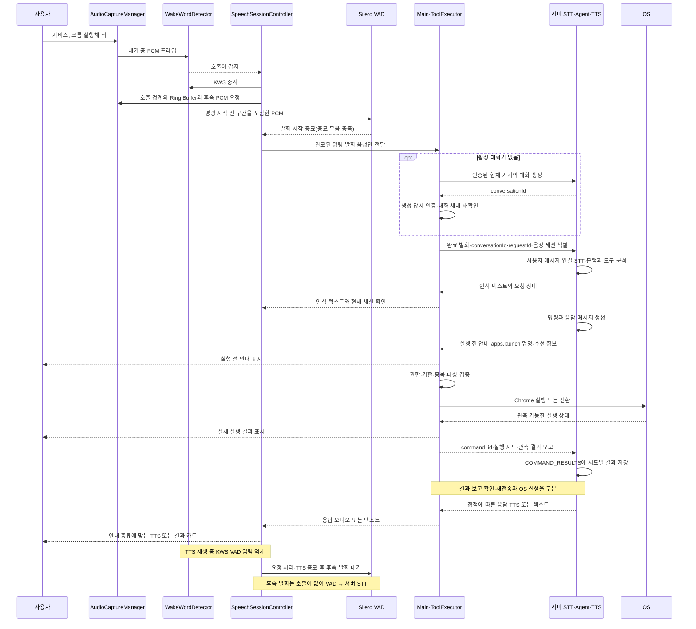

# 음성과 AI 요청

요구사항 ID: VOICE-01~04, AI-01~04. 음성 세션 상태 전이는 이 문서를 기준으로 한다. 대화와 음성 세션은 서로 다른 개념이며 관계는 [아래](#대화와-음성-세션의-관계)에 둔다.

로컬 PCM·완료 발화·재생·취소 계약은 [공통 인터페이스](../architecture/client-interfaces.md#음성미디어)를 따른다. 서버 전송 메타데이터는 로컬 캡처 데이터와 분리한다.

## 음성과 AI 요청

| ID | 기능 | 동작 기준과 완료 조건 | 범위 |
| --- | --- | --- | --- |
| VOICE-01 | 음성 입력·구간 감지 | AudioCaptureManager가 공통 마이크 PCM 스트림과 길이 제한 Ring Buffer를 관리. 호출 후 Silero VAD가 발화 시작·종료를 판단하고 시작 대기·종료 무음·최대 발화 시간을 적용. 시작 대기 초과·무음은 빈 발화, 최대 발화 초과는 확정 또는 오류 정책으로 처리 | MVP |
| VOICE-02 | 서버 STT | VAD가 완료로 확정한 발화 음성만 인증된 연결로 서버에 전송해 텍스트로 변환. 대기 음성·무음·취소된 발화는 전송하지 않음. 실패·빈 텍스트면 재입력 경로 제공. 서버가 수신한 요청의 STT 실패도 같은 requestId에 연결. 늦은 결과는 음성 세션 ID와 상태 버전으로 폐기 | MVP |
| AI-01 | 의도 분석 | 서버가 입력 텍스트·현재 기기의 가용 도구·해당 대화의 이전 메시지 일부로 대상과 동작을 결정. 앱 후보가 여러 개면 선택 요청. 문맥 선택은 서버가 담당 | MVP |
| AI-02 | 도구 실행 연계 | 서버의 응답·구조화된 명령 목록 수신 → 클라이언트 검증·순차 실행 → 명령별 결과 보고. 실행 전 안내와 실제 결과를 구분하고 응답 수신만으로 실행 성공이나 요청 완료로 처리하지 않음 | MVP |
| AI-03 | 취소·만료 | 요청별 취소와 유효 시간을 적용. 취소·만료 후 시작되지 않은 작업은 실행하지 않음 | MVP |
| AI-04 | 대화 | 활성 대화가 없으면 서버에 생성해 받은 conversationId로 요청(requestId)을 이어감. 음성·글을 한 대화에서 혼합하고 한 번에 하나의 요청만 처리. 생성·응답·실행에 기한을 적용하고 중지·로그아웃·일시 중지·서버 종료·유휴 시간 초과 이후 늦은 응답을 적용하지 않음. 서버 메시지 저장·문맥 연결과 대화 원문 보관 정책을 구분 | MVP |
| VOICE-03 | 서버 TTS 응답 | 서버 응답 오디오를 재생·중단하며 실행 전 안내를 성공 결과로 읽지 않음. 오디오 생성 실패 시 텍스트 표시. 재생 중 KWS·VAD 입력을 중지하거나 폐기하고 재생 경계의 버퍼를 비움. 요청 처리·재생 종료 후 후속 발화 대기로 복귀. 안내·결과의 TTS 순서는 연동 전에 확정. MVP는 응답 중 끼어들기 미지원 | MVP |
| VOICE-04 | 음성 세션 종료 | 같은 대화의 후속 발화는 호출어 없이 VAD로 수집. 명시적 종료·후속 발화 대기 시간 초과·취소 시 음성 세션과 대기 작업을 정리하고, 음성 호출 설정·마이크 권한이 유효하면 KWS 대기로 복귀(호출어 엔진 도입 전에는 `idle`). 대화는 AI-04에 따라 음성 세션이 끝난 뒤에도 남을 수 있고, 대화가 끝나면 음성 세션도 끝남. 제스처 제어는 독립 유지 | MVP |

## 대화 생성과 요청 완료

Main의 ConversationManager가 현재 사용자·기기의 활성 대화를 관리한다. 활성 대화가 없으면 서버에 생성을 요청하고, 성공한 대화 ID를 확보한 뒤 요청을 제출한다. 생성 대기 중 추가 호출로 대화를 중복 생성하지 않으며 생성 실패는 재시도 가능한 오류로 표시한다. 생성 중 취소·로그아웃·일시 중지가 발생하면 로컬 세대를 먼저 무효화하고 늦게 도착한 대화 ID로 입력·명령을 시작하지 않는다.

서버는 요청 메시지에 입력 방식·처리 상태·오류를 연결하고 이전 메시지 일부와 가용 도구로 계획을 만든다. 식별자와 음성/텍스트 중복 제출 방지 규칙은 [대화·메시지 계약](../architecture/server-integration.md#대화메시지와-요청-식별)을 따른다. 서버 메시지 저장은 문맥 처리에 포함하되 본문 보관과 과거 대화 화면의 범위는 [데이터와 보안](../architecture/data-security.md#대화와-일정-저장)을 따른다.

응답에 포함된 실행 전 안내는 즉시 표시할 수 있지만, 실행 중인 명령을 성공으로 표시하지 않는다. 처리 중에는 새 요청을 거절하는 기존 규칙을 유지한다. 실행 단계는 명령별 로컬 결과가 확정되면 종료하고 결과 보고 완료·보고 대기는 별도 상태로 구분한다. 전체 요청의 완료 통지와 보고 기한은 [결정 목록](../delivery/validation.md#서버-erd-반영-후-결정-목록)에서 확정하며 응답 수신을 종료 신호로 쓰지 않는다. 명령 없는 일반 응답은 명령 실행을 기다리지 않는다.

사용자 중지·로그아웃·일시 중지는 재생과 미시작 명령을 즉시 중단한다. 이미 실행한 결과는 보존하고 보고 재시도 때문에 OS 동작을 반복하지 않는다. 서버가 응답에 대화 종료를 요청해도 해당 응답에 연결된 허용 명령·결과 처리를 조기에 닫지 않도록 종료 시점을 구분한다. 서버 종료와 사용자 취소를 같은 신호로 처리하지 않는다. 추천 승인을 기다리는 동안 일반 요청을 무기한 붙잡지 않으며, 승인 후에는 [추천 계약](activity-recommendation.md#추천-승인)에 따른 별도 실행을 연결한다.

현재 F-017·F-020 구현은 로컬에서 동기적으로 대화 ID를 생성하고 `AssistantPort.respond` 중에 도구를 실행한 뒤 최종 응답을 받는다. 서버 대화 생성·실행 전 응답·결과 보고 수명은 아직 구현하지 않았으며 해당 상태·포트 확장이 필요하다. 이미 완료된 구현 항목이 이 목표 계약까지 검증했다는 뜻은 아니다.

## 음성으로 앱 실행

아래는 서버 연동 목표 흐름이다. TTS 재생 시점과 결과 확인 응답의 wire 계약은 결정 목록에서 확정한다.

호출과 명령이 이어질 때는 호출어 감지 시점부터만 녹음하지 않는다. AudioCaptureManager의 길이 제한 Ring Buffer에서 호출 경계 주변의 PCM과 감지 후 PCM을 이어 첫 명령의 시작을 보존한다. 호출어 자체는 전송할 명령 구간에서 분리하고, 명령 일부를 잘라내지 않도록 경계와 사전 음성 구간을 검증한다. VAD가 발화 시작 대기·종료 무음·최대 발화 정책으로 구간을 확정한 후에만 그 구간을 서버 STT에 전송한다. 무음·취소·권한 철회에서는 음성 업로드를 만들지 않는다. 업로드 완료·취소·오류 후 원시 오디오와 버퍼는 메모리에서 폐기하며 오프라인 재전송 대기열에 넣지 않는다.

## 음성 세션과 인식 엔진 상태

| 음성 상태 | WakeWordDetector | VAD | 서버 STT 요청 | 전이 조건 |
| --- | --- | --- | --- | --- |
| idle (음성 호출 켜짐) | 실행 | 중지 | 중지 | 호출어 감지 시 wake_detected. 호출 꺼짐·인식 일시 중지·마이크 권한 없음이면 PCM 수집까지 중지 |
| wake_detected / awaiting_speech | 중지 | 실행 | 중지 | Ring Buffer의 호출 직후 PCM을 연결하고 발화 시작 대기. 시작 타임아웃이면 세션 종료 |
| listening | 중지 | 실행 | 중지 | 종료 무음 충족 시 발화 확정. 최대 발화 시간 초과 시 정책에 따라 확정 또는 오류 |
| transcribing | 중지 | 중지 | 완료 발화에만 요청 | 서버 STT 텍스트가 있으면 processing. 빈 결과·오류면 재입력 안내 후 awaiting_followup 또는 종료 |
| processing | 중지 | 중지 | 완료 | 대화(AI-04)의 응답·명령 실행을 처리. 실행 전 안내 수신만으로 후속 발화를 시작하지 않음. 오디오 재생 시 speaking, TTS 오류 시 텍스트 결과 표시 |
| speaking | 중지 | 중지 | 중지 | 서버 TTS 오디오의 자체 출력은 인식 입력에서 제외. 재생 종료 후 요청 처리가 남으면 processing, 완료되면 awaiting_followup. 명시적 중지는 즉시 종료 |
| awaiting_followup | 중지 | 실행 | 중지 | 호출어 없이 다음 발화 수집. 발화 완료 시 transcribing, 대기 타임아웃·명시적 종료면 idle |

SpeechSessionController는 모든 이벤트에 음성 세션 ID와 상태 버전을 붙이고, 서버 요청에는 대화 ID와 요청 ID를 함께 붙여 STT 결과와 응답이 같은 요청에 연결되게 하며 이전 발화의 늦은 KWS/VAD/서버 STT·TTS 결과를 폐기한다. TTS 재생 시작과 종료·중단 경계에서 Ring Buffer를 비워 자체 출력이 후속 발화로 유입되지 않게 한다. 취소·마이크 중지·권한 철회·인식 일시 중지 시 진행 중인 음성 업로드와 TTS 수신·재생의 취소를 시도하고, 확정되지 않은 음성·Ring Buffer를 즉시 폐기한다. 서버에서 이미 시작된 처리는 취소가 보장되지 않으므로 늦게 도착한 응답을 적용하지 않는다. 마이크 사용 기능이 남아 있지 않으면 SensorManager가 장치를 해제한다. 도구 실행 중 취소는 [서버 연동의 취소 규칙](../architecture/server-integration.md#취소와-오류-규칙)을 따른다. TTS 중 끼어들기는 MVP 범위 밖이며, 사용자는 트레이·단축키로 응답을 중단할 수 있다.

## 구현 현황: 로컬 음성 입력

F-015([#16](https://github.com/CCCR-TeamProj-01/Jarvis-client/issues/16))에서 VOICE-01의 입력 쪽을 구현했다. 이후 음성 세션·서버 대역·응답 재생 구현은 [아래](#구현-현황-대화음성-세션응답-재생)에 둔다. F-024의 호출어 구현과 남은 검증은 [호출어 감지](#호출어-감지-구현과-검증)를 따른다.

| 위치 | 책임 |
| --- | --- |
| `src/renderer/media/audio-capture/` | AudioWorklet으로 16 kHz mono PCM을 수집해 100 ms 단위 연속 청크로 Main에 전달. 30초 순환 버퍼를 같은 절대 샘플 번호로 보관하고 구간 추출·폐기를 처리 |
| `src/main/speech/audio-input.ts` | 청크의 세대·연속성 검사, 듣는 쪽이 없으면 폐기, 완료 구간 추출 요청과 응답 대응 |
| `src/inference/vad/` | Silero VAD(sherpa-onnx)와 타이밍 규칙(`VadEngine`). utilityProcess 워커에서 실행하고 Main은 `src/main/speech/vad-process.ts`로 연결 |
| `src/main/speech/voice-input.ts` | 마이크 사용권 → VAD → 완료 구간 추출을 묶어 발화 하나를 받는 `listen()`. 끝나면 VAD 중지·버퍼 폐기·사용권 반납 |

동작 기준은 다음과 같다.

- 마이크 사용권이 열리면 수집이 시작되고, 사용권이 닫히면 수집이 멈추며 버퍼가 폐기된다. 로그아웃·일시 중지·권한 철회로 사용권이 철회되면 `listen()`이 즉시 끝난다.
- Main은 VAD를 시작한 뒤에만 PCM을 처리하며, VAD 시작 중 들어온 오디오는 순서대로 보관했다가 재생한다. 오디오에 끊김이 있으면 수집을 종료하고 이어 붙이지 않는다.
- VAD 정책(`VadPolicy`)은 세션이 주입한다. 기본값은 측정 전 잠정값이다: 시작 대기 6초, 종료 무음 700 ms, 최대 발화 15초, 사전 구간 300 ms, 최소 발화 150 ms. 오디오 처리 제약(에코 제거·잡음 억제·자동 이득)은 브라우저 기본값이며 실기기 측정 후 정한다.
- 발화 하나가 끝나면 VAD는 종료된다. 다음 발화는 새로 시작한다(후속 발화는 세션이 다시 `listen()`을 호출).
- 모델은 저장소에 없다. `pnpm models:fetch`가 `resources/models/`에 내려받아 해시를 검증하고, 패키징은 `resources/models/*.onnx`를 포함한다.
- 개발용: 패키징되지 않은 앱에서 `JARVIS_FAKE_MEDIA=1`과 `JARVIS_FAKE_AUDIO_FILE=<wav>`로 파일을 마이크 입력으로 쓰고, `JARVIS_VOICE_SELFTEST=<횟수>`로 로그인 후 그 횟수만큼 `listen()`한 결과(오디오 제외)를 `VOICE_SELFTEST` 줄로 출력한다. 가짜 마이크는 사용권을 다시 열 때마다 파일을 처음부터 재생한다.

## 호출어 감지 구현과 검증

F-024([#49](https://github.com/CCCR-TeamProj-01/Jarvis-client/issues/49))에서 `vosk-model-small-ko-0.22`를 호출어 용도로 연결한다. 명령의 텍스트 변환은 VOICE-02의 서버 STT, 응답 음성 생성은 VOICE-03의 서버 TTS를 유지한다. 로컬 Vosk 인식 본문은 화면·로그·디스크·서버에 전달하지 않는다.

| 위치 | 책임 |
| --- | --- |
| `src/inference/wake-word/` | 고정 어휘·형식·시간 경계 검증과 Vosk C API 호출, 별도 utilityProcess 진입점 |
| `src/main/speech/wake-process.ts` | 프로세스 시작/오류/종료·세대 검증·미처리 PCM 제한 |
| `src/main/speech/wake-word.ts`, `create-wake-word.ts` | 로그인·수집 허용·옵트인에 따른 voice_wake 사용권, 대기/중지·첫 명령의 음성 세션 인계 |
| `VoiceInput`, `SpeechSessionController` | 호출어 끝 이후 이미 수집된 구간을 VAD에 먼저 재생한 뒤 새 PCM에 연결. 음성 사용권 취득 후 대기 사용권 반납 |
| 설정 탭·Main `wake_word.set_enabled` | 이번 실행의 음성 호출 켜기·끄기와 상태 표시. 기본 OFF, 계정 변경·재실행 후 OFF |

모델은 `pnpm models:wake:fetch`로 설치하며 `pnpm models:fetch`에도 포함한다. 공식 ZIP·엔진 TGZ의 SHA-256을 고정하고 디렉터리와 현재 플랫폼의 네이티브 엔진을 패키지 resources에 넣는다. Koffi는 asar 밖에 둔다. 지원 자산은 macOS x64/arm64, Windows x64이며 실제 검증 결과는 PR과 진행 로그로 구분한다. 모델·네이티브 파일이 없거나 로딩이 실패하면 대기를 오류 상태로 중단하고 단축키·트레이 시작 경로를 유지한다.

전체 어휘 그래프의 결과에서 정확히 `자비스`로 인식된 단어의 시각과 잠정 신뢰도 0.3 이상을 사용한다. 이 값은 브라우저 입력에서 인식 신뢰도가 낮아지는 합성 사례로 정한 초기 검증값이며 실제 화자로 보정해야 한다. 호출어와 `<UNK>`로만 후보를 좁히면 비호출 합성 문장에서 오탐이 재현돼 제한 문법은 사용하지 않는다. `자비스야`·유사 문자열은 자동 치환하지 않는다. 높은 신뢰도가 오탐 방지를 보장하지 않으므로 실제 화자·거리·잡음·영상 재생에서 별도 검증한다. 모델은 로컬 호출어 판별용 ASR이며 전용 KWS와 동일한 감지 지연을 가정하지 않는다.

처리·응답 재생·후속 발화 중에는 호출어 감지를 중단한다. 일시 중지 후 재개는 현재 실행의 옵트인을 유지하지만 계정 세대 변경은 해제한다. 모델/입력 오류 후 자동 재시작 루프를 만들지 않으며 사용자가 OFF→ON으로 재시도한다. 호출어 인계 시 capture 세대가 바뀌거나 버퍼가 없어졌거나 인계 구간이 5초를 넘으면 명령 앞부분을 생략해 실행하지 않고 재입력을 안내한다. 대기·인계 오디오는 메모리·기존 Ring Buffer에만 있고 종료 시 폐기한다.

합성 음성·가짜 마이크·단위 테스트의 성공과 실제 화자 오탐/미탐 검증을 구분한다. 사람 음성, 시간당 오탐·미탐·지연 및 OS별 실기기/패키지 확인 전에는 CALL-01 전체나 #1의 로컬 음성 처리를 완료로 표시하지 않는다.

오프라인 모델 확인은 `pnpm build` 후 `pnpm wake:probe <mono-16k-pcm.wav>`로 실행한다. 이 도구는 명시한 짧은 WAV만 읽고 마이크를 열지 않으며 런타임·샘플 수·로드 시간·호출 이벤트만 출력한다. 감지 0건도 정상 종료하므로 호출/비호출 샘플의 예상 결과와 비교해야 한다. 오디오를 실제 시간보다 빠르게 처리하므로 도구의 실행 시간을 사용자 체감 감지 지연으로 간주하지 않는다.

## 대화와 음성 세션의 관계

대화(conversation)와 음성 세션(speech session)은 다른 것이다.

- **대화**는 사용자와 자비스 사이의 한 흐름이다. 요청(requestId)이 이어지고 서버와는 `conversationId`로 연결되며, 입력이 음성이든 글이든 같다. 소유자는 `ConversationManager`(`src/main/conversation/`)다.
- **음성 세션**은 그 대화에 붙는 듣기·말하기 방식이다. 마이크로 듣고, 서버 STT로 글로 바꿔 대화에 제출하고, 응답 오디오를 재생한다. 소유자는 `SpeechSessionController`(`src/main/speech/session/`)다.

한 대화에서 음성 턴과 텍스트 턴이 섞일 수 있고, 음성 세션 없이 글로만 이어 가는 대화도 있다. 음성 세션이 끝나도(예: 후속 발화 대기 초과) 대화는 남을 수 있다. 반대로 대화가 끝나면 음성 세션도 끝난다. 서버의 정상 종료 지시에는 마지막 응답 재생을 마칠 수 있지만 사용자 중지·로그아웃·일시 중지는 재생을 기다리지 않고 즉시 정리한다. 요청 처리와 서버 종료 시점은 [요청 완료 규칙](#대화-생성과-요청-완료)을 따른다.

| 책임 | 대화 (`ConversationManager`) | 음성 세션 (`SpeechSessionController`) |
| --- | --- | --- |
| 식별 | `conversationId`, 요청 ID, 상태 버전 | 음성 세션 ID, 상태 버전 |
| 서버 | 응답 요청(`AssistantPort.respond`), 응답 시간 제한 | 음성 인식 요청(`RemoteSpeechPort.transcribe`), 인식 시간 제한 |
| 사용자에게 | "나: …"·"자비스: …" 메시지와 응답 오류 | 듣기·재생 쪽 문제(인식 실패, 재생 실패) |
| 상태 | `conversation`·`request` 스냅샷 | `speech` 스냅샷 |
| 끝내는 조건 | 중지, 서버 종료 지시, 유휴 5분(음성 세션이 열려 있으면 제외) | 발화 없음, 후속 대기 초과, 연속 실패, 중지, 대화 종료 |

## 구현 현황: 대화·음성 세션·응답 재생

F-016([#18](https://github.com/CCCR-TeamProj-01/Jarvis-client/issues/18))과 F-017([#19](https://github.com/CCCR-TeamProj-01/Jarvis-client/issues/19))에서 개발용 서버 대역 기반 음성 세션과 텍스트 입력 경로를 구현했고 F-020에서 로컬 도구 실행을 연결했다. F-024에서 음성 호출 경로를 추가한다. 실제 서버 연동·대화 생성과 저장·새 요청 완료 계약, 응답 중 끼어들기는 후속이다. 아래는 현재 코드 동작이며 위의 서버 연동 목표와 구분한다. 음성 호출이 OFF여도 단축키·트레이·화면의 `대화 시작`(`conversation.start`)은 유지하고, 글은 화면의 입력창(`conversation.submit_text`)으로 보낸다.

서버 어댑터(F-030, [#62](https://github.com/CCCR-TeamProj-01/Jarvis-client/issues/62))로 글 입력은 서버의 대화·요청 API로 처리할 수 있다. 서버 주소가 유효하고 개발용 대역(`JARVIS_DEV_SPEECH=1`)이 꺼져 있을 때 선택되며, 음성 입력의 서버 전송과 명령 실행은 아직 연결하지 않았다. 동작은 [구현 현황: 대화·요청 어댑터](../architecture/server-integration.md#구현-현황-대화요청-어댑터)에 둔다.

| 위치 | 책임 |
| --- | --- |
| `src/main/conversation/` | 대화 식별·요청 상태·응답 처리·유휴 종료, 서버 응답 포트(`AssistantPort`) |
| `src/main/speech/session/speech-session.ts` | 음성 상태 전이(세션 ID·상태 버전), 시간 제한, 실패 한도, 취소·정리, 늦은 결과 폐기 |
| `src/main/speech/remote-speech/` | 서버 음성 인식 포트, 개발용 대역(인식과 응답 모두), 연결 불가 기본 어댑터, 선택 규칙 |
| `src/main/speech/playback.ts`, `src/renderer/media/audio-playback/element-playback.ts` | Main의 재생 요청·이벤트 중계와 Media Renderer의 실제 재생(started·ended·stopped·failed) |

동작 기준은 다음과 같다.

- 음성 상태는 `idle → awaiting_speech → listening → transcribing → processing → speaking → awaiting_followup`로 전이하고 후속 발화는 호출어 없이 이어진다(`processing`은 대화가 응답을 만드는 동안). 호출어로 시작하면 `wake_detected`가 그 앞에 붙는다. 단축키로 시작하면 곧바로 `awaiting_speech`다.
- 마이크 사용권은 `listen()` 동안에만 잡는다. 서버 처리와 응답 재생 중에는 마이크가 닫혀 있으므로 응답 소리가 인식 입력에 섞이지 않고, 후속 발화는 마이크를 다시 열어 받는다(재오픈 지연은 측정 후 검토).
- 시간 제한(잠정값, 정책으로 주입): 첫 발화 대기 6초, 후속 발화 대기 8초, 서버 단계당 20초, 재생 안전 한도 60초, 대화 유휴 5분. 빈 인식·인식 실패·응답 실패는 안내하고 이어 가며, 음성에서 연속 2회 실패하면 음성 세션을 끝낸다.
- 응답 텍스트는 재생을 기다리지 않고 바로 보여 준다. 음성이 없는 응답이나 재생 실패는 텍스트만 보여 준다.
- F-023의 기기 음성 출력 설정을 응답 재생 전에 확인한다. 저장 필드·기본값과 적용 시점은 [기기 로컬 저장 형식](../architecture/data-security.md#기기-로컬-저장-형식)을 따른다. 음성 출력을 꺼도 텍스트 응답·후속 발화는 유지한다.
- 한 번에 하나의 요청만 처리한다. 처리 중에 온 다른 입력은 거절하고 안내한다.
- 중지·로그아웃·인증 세대 변경·인식 일시 중지는 듣기·서버 요청·재생을 즉시 취소하고 서버 응답을 기다리지 않는다. 끝난 대화·세션에 늦게 도착한 인식·응답·재생 이벤트는 적용하지 않는다. 마이크 사용권이 철회되면 듣기가 끝나며 안내한다.
- 서버 요청에는 요청 ID와 요청 시점의 식별자(대화 ID 또는 음성 세션 ID와 상태 버전)를 붙인다. 완료 발화 바이트는 인식 요청이 끝나면 더 보관하지 않는다.
- UI: 현재 상태 문구, 인식된 말과 응답 텍스트(최근 6줄), 글 입력창, `대화 시작`/`음성으로 이어가기`/`대화 중지` 버튼을 보여 준다. 오류는 기존 오류 알림으로 표시한다.
- 개발용(패키징되지 않은 앱 한정): `JARVIS_DEV_SPEECH=1`이 서버 대역을 켜고(`JARVIS_DEV_SPEECH_TURNS`로 몇 번째 응답에서 종료할지 지정, 기본 2), `JARVIS_SPEECH_SELFTEST=1`이 로그인 직후 음성 대화를 시작해 상태 변화와 알림을 `SPEECH_SELFTEST` 줄로 출력한다. 대역은 고정 인식 문구와 짧은 효과음(WAV)으로 답하며 오디오를 저장하지 않는다.
