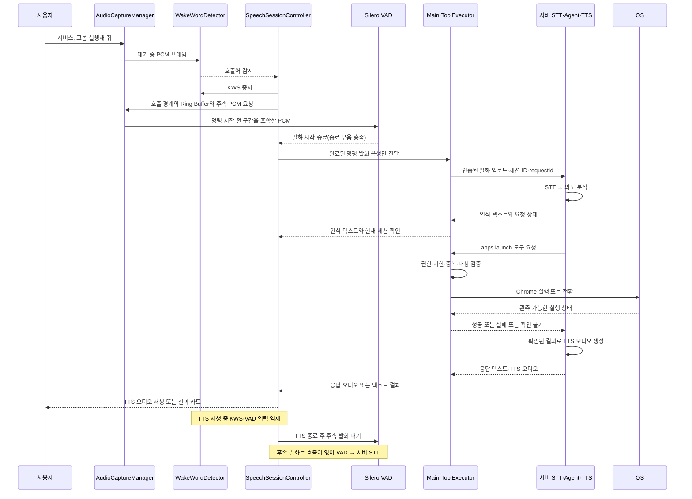

# 음성과 AI 요청

요구사항 ID: VOICE-01~04, AI-01~03. 음성 세션 상태 전이는 이 문서를 기준으로 한다.

로컬 PCM·완료 발화·재생·취소 계약은 [공통 인터페이스](../architecture/client-interfaces.md#음성미디어)를 따른다. 서버 전송 메타데이터는 로컬 캡처 데이터와 분리한다.

## 음성과 AI 요청

| ID | 기능 | 동작 기준과 완료 조건 | 범위 |
| --- | --- | --- | --- |
| VOICE-01 | 음성 입력·구간 감지 | AudioCaptureManager가 공통 마이크 PCM 스트림과 길이 제한 Ring Buffer를 관리. 호출 후 Silero VAD가 발화 시작·종료를 판단하고 시작 대기·종료 무음·최대 발화 시간을 적용. 시작 대기 초과·무음은 빈 발화, 최대 발화 초과는 확정 또는 오류 정책으로 처리 | MVP |
| VOICE-02 | 서버 STT | VAD가 완료로 확정한 발화 음성만 인증된 연결로 서버에 전송해 텍스트로 변환. 대기 음성·무음·취소된 발화는 전송하지 않음. 실패·빈 텍스트면 재입력 경로 제공. 늦은 결과는 음성 세션 ID와 상태 버전으로 폐기 | MVP |
| AI-01 | 의도 분석 | 서버가 텍스트·가용 도구·최소 컨텍스트로 대상과 동작을 결정. 앱 후보가 여러 개면 선택 요청 | MVP |
| AI-02 | 도구 실행 연계 | 서버 도구 요청 → 클라이언트 검증·실행 → 결과 반환 → 최종 응답 연결 | MVP |
| AI-03 | 취소·만료 | 요청별 취소와 유효 시간을 적용. 취소·만료 후 시작되지 않은 작업은 실행하지 않음 | MVP |
| VOICE-03 | 서버 TTS 응답 | 서버가 확인된 결과로 TTS 오디오를 생성하고 클라이언트가 재생·중단. 오디오 생성 실패 시 텍스트 결과를 표시. 재생 중 KWS·VAD 입력을 중지하거나 폐기하고 재생 경계의 오디오 버퍼를 비운 뒤 후속 발화 대기로 복귀해 자체 음성 재인식을 방지. MVP는 응답 중 끼어들기 미지원 | MVP |
| VOICE-04 | 대화 종료 | 같은 대화의 후속 발화는 호출어 없이 VAD로 수집. 명시적 종료·후속 발화 대기 시간 초과·취소 시 음성 세션과 대기 작업을 정리하고, 음성 호출 설정·마이크 권한이 유효하면 KWS 대기로 복귀. 제스처 제어는 독립 유지 | MVP |

## 음성으로 앱 실행

호출과 명령이 이어질 때는 호출어 감지 시점부터만 녹음하지 않는다. AudioCaptureManager의 길이 제한 Ring Buffer에서 호출 경계 주변의 PCM과 감지 후 PCM을 이어 첫 명령의 시작을 보존한다. 호출어 자체는 전송할 명령 구간에서 분리하고, 명령 일부를 잘라내지 않도록 경계와 사전 음성 구간을 검증한다. VAD가 발화 시작 대기·종료 무음·최대 발화 정책으로 구간을 확정한 후에만 그 구간을 서버 STT에 전송한다. 무음·취소·권한 철회에서는 음성 업로드를 만들지 않는다. 업로드 완료·취소·오류 후 원시 오디오와 버퍼는 메모리에서 폐기하며 오프라인 재전송 대기열에 넣지 않는다.

## 음성 세션과 인식 엔진 상태

| 음성 상태 | WakeWordDetector | VAD | 서버 STT 요청 | 전이 조건 |
| --- | --- | --- | --- | --- |
| idle (음성 호출 켜짐) | 실행 | 중지 | 중지 | 호출어 감지 시 wake_detected. 호출 꺼짐·인식 일시 중지·마이크 권한 없음이면 PCM 수집까지 중지 |
| wake_detected / awaiting_speech | 중지 | 실행 | 중지 | Ring Buffer의 호출 직후 PCM을 연결하고 발화 시작 대기. 시작 타임아웃이면 세션 종료 |
| listening | 중지 | 실행 | 중지 | 종료 무음 충족 시 발화 확정. 최대 발화 시간 초과 시 정책에 따라 확정 또는 오류 |
| transcribing | 중지 | 중지 | 완료 발화에만 요청 | 서버 STT 텍스트가 있으면 processing. 빈 결과·오류면 재입력 안내 후 awaiting_followup 또는 종료 |
| processing | 중지 | 중지 | 완료 | 서버의 도구 결과와 TTS 오디오를 기다림. 오디오 재생 시 speaking, TTS 오류 시 텍스트 결과를 표시 |
| speaking | 중지 | 중지 | 중지 | 서버 TTS 오디오의 자체 출력은 인식 입력에서 제외. 재생 종료·중단 시 awaiting_followup |
| awaiting_followup | 중지 | 실행 | 중지 | 호출어 없이 다음 발화 수집. 발화 완료 시 transcribing, 대기 타임아웃·명시적 종료면 idle |

SpeechSessionController는 모든 이벤트에 음성 세션 ID와 상태 버전을 붙여 이전 발화의 늦은 KWS/VAD/서버 STT·TTS 결과를 폐기한다. TTS 재생 시작과 종료·중단 경계에서 Ring Buffer를 비워 자체 출력이 후속 발화로 유입되지 않게 한다. 취소·마이크 중지·권한 철회·인식 일시 중지 시 진행 중인 음성 업로드와 TTS 수신·재생의 취소를 시도하고, 확정되지 않은 음성·Ring Buffer를 즉시 폐기한다. 서버에서 이미 시작된 처리는 취소가 보장되지 않으므로 늦게 도착한 응답을 적용하지 않는다. 마이크 사용 기능이 남아 있지 않으면 SensorManager가 장치를 해제한다. 도구 실행 중 취소는 [서버 연동의 취소 규칙](../architecture/server-integration.md#취소와-오류-규칙)을 따른다. TTS 중 끼어들기는 MVP 범위 밖이며, 사용자는 트레이·단축키로 응답을 중단할 수 있다.
